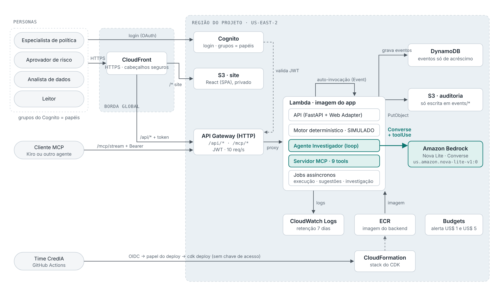
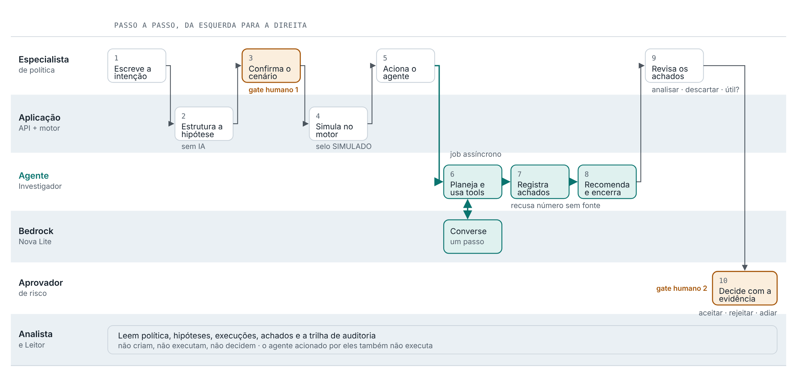

# Policy Playground — Technical Spec (Spec-Driven Development)

Entrega documental do **Policy Playground** para o hackathon (AWS Builders League). Este repositório contém a especificação técnica do projeto seguindo o fluxo de Spec-Driven Development do Kiro: **Requirements → Design → Tasks**.

> **Especificação + MVP agêntico de demonstração.** Além do spec, o repositório traz um MVP funcional sobre o fixture **sintético** (`app/`), com o `SimulatedRunner` e o **Agente Investigador** (R17): todo número exibido leva o selo SIMULADO e não é impacto real. Os condicionais C1–C5 (runner real, PR real etc.) não estão implementados.

## O que é o Policy Playground

Um ambiente interativo para especialistas de política de crédito testarem hipóteses de negócio sem escrever SQL ou Python, visualizarem impacto com evidência e investigarem cenários não previstos com apoio de agentes de IA.

Princípio central do produto:

> **AI proposes. Deterministic execution proves. Humans decide.**
>
> A IA interpreta intenção, estrutura hipóteses e sugere investigações. A execução determinística é a única fonte dos números de impacto. A decisão final é sempre humana.

## Arquitetura atual na AWS

Perfil demo serverless (ADR-19) com a camada agêntica (R17), na região do projeto (**us-east-2**). Tudo é cobrado por uso; não há custo fixo por hora.



| Componente | Papel |
| --- | --- |
| **CloudFront** | Serve o site (S3 privado) e repassa `/api/*` ao API Gateway, na mesma origem |
| **Cognito** | Login; os grupos são os papéis do produto |
| **API Gateway (HTTP)** | Rotas `/api/*` e `/mcp/*`, autorizador JWT do Cognito, throttling de 10 req/s |
| **Lambda** (imagem do app) | API (FastAPI + Lambda Web Adapter), motor determinístico, Agente Investigador, servidor MCP e jobs assíncronos por auto-invocação |
| **DynamoDB** | Eventos só de acréscimo, projeções e chaves de idempotência |
| **S3 · auditoria** | Cópia de cada evento; a Lambda só tem `PutObject` em `events/*` |
| **Amazon Bedrock** | Nova Lite pela Converse com tool use; só o job do agente chama o modelo |
| **CloudWatch Logs, ECR, Budgets** | Logs por 7 dias, imagem do backend, alertas em US$ 1 e US$ 5 |
| **GitHub Actions + CloudFormation** | Deploy pelo CDK com papel assumido via OIDC, sem chave de acesso |

Fora deste perfil ficam Fargate, ALB, VPC endpoints, WAF, SQS e Object Lock, que são da arquitetura-alvo em [arquitetura/arquitetura-da-aplicacao.md](arquitetura/arquitetura-da-aplicacao.md). A fonte dos diagramas está em [arquitetura/fontes/arquitetura-demo-aws.html](arquitetura/fontes/arquitetura-demo-aws.html).

## Fluxo funcional



1. O especialista escreve a intenção e a aplicação estrutura a hipótese, sem IA.
2. **Gate humano 1:** o especialista confirma o cenário. Nada é simulado antes disso.
3. O motor simula baseline e cenário no dataset sintético (selo SIMULADO).
4. O especialista aciona o agente, que roda como job assíncrono.
5. O agente escreve um plano, chama as tools, testa ao menos uma variação do cenário, compara as execuções e registra achados. Um número sem fonte numa execução é recusado e o agente corrige.
6. O agente encerra com uma recomendação. Ele não decide.
7. O especialista revisa os achados (analisar, descartar, marcar como útil).
8. **Gate humano 2:** o aprovador de risco ou o especialista decide (aceitar, rejeitar ou adiar) com a evidência e a trilha de auditoria.

## Personas

| Persona | Grupo do Cognito | Pode | Não pode |
| --- | --- | --- | --- |
| Especialista de política | `policy-specialist` | Criar hipótese, confirmar cenário, simular, acionar o agente, revisar achados e decidir | — |
| Aprovador de risco | `risk-approver` | Ler tudo e registrar a decisão (aceitar, rejeitar, adiar) | Criar hipóteses, simular, acionar o agente |
| Analista de dados | `data-analyst` | Ler política, hipóteses, execuções, achados e trilha | Executar ou decidir (no MVP, mesmas permissões do leitor) |
| Leitor | `viewer` | Somente ler | Mudar estado, inclusive por meio do agente ou do MCP |
| **Agente Investigador** (não humano) | age como quem o acionou | Planejar, usar as 9 tools, simular variações, registrar achados e recomendar | Inventar números, alterar a política, decidir |
| Cliente MCP (Kiro ou outro agente) | dono do token | Usar as mesmas 9 tools em `/mcp/stream` | Ir além das permissões do dono do token |
| Time CredIA (deploy) | papel via OIDC | Publicar e destruir a demo pelos workflows, só a partir da `main` | Usar chave de acesso |

## Agente Investigador (R17)

O motor determinístico virou o conjunto de ferramentas do agente. O agente decide o que investigar e em que ordem; os números vêm só das execuções. Código em [`app/backend/policy_playground/agent/`](app/backend/policy_playground/agent/).

| Tool | O que faz |
| --- | --- |
| `get_policy` | Lê regras, parâmetros e DAG |
| `preview_subdag` | Mostra o que pode mudar com um parâmetro, sem executar |
| `trace_output` | Rastreia as regras que decidem uma saída |
| `run_scenario` | Executa baseline × cenário no `SimulatedRunner` e devolve `executionId` e `deltas` |
| `compare` | Compara uma execução com o baseline ou duas execuções entre si |
| `get_candidates` | Candidatos determinísticos G1 e G2 |
| `read_audit` | Lê a trilha da investigação e achados anteriores |
| `register_finding` | Registra um achado ligado a execuções; número sem fonte é recusado |
| `submit_recommendation` | Encerra com a recomendação, com a mesma checagem de números |

**Limites (FinOps):** 14 passos, 6 simulações e 40 mil tokens por investigação; 3 investigações por hipótese. Sem modelo configurado, a investigação cai para os candidatos G1/G2 e a tela avisa.

**MCP:** as mesmas tools ficam em `/mcp/stream` (Streamable HTTP, stateless). Na AWS, a saída `McpUrl` do deploy dá o endereço, com `Authorization: Bearer <token do Cognito>`. Localmente, o `.kiro/settings/mcp.json` traz o servidor `policy-playground` apontando para `http://localhost:8000/mcp/stream`; habilite-o no Kiro com o backend rodando.

## Estrutura do repositório

```
.
├── .kiro/
│   └── specs/
│       └── policy-playground/          ← spec reconhecido pelo Kiro
│           ├── requirements.md
│           ├── design.md
│           ├── tasks.md
│           └── fixtures/
│               ├── policy-playground-demo-policy.json      ← Policy Spec (não alterado)
│               ├── policy-playground-demo-extensions.json  ← metadados do Playground
│               ├── policy-playground-demo-dataset.json     ← propostas sintéticas
│               └── policy-playground-demo-policy-README.md
├── app/
│   ├── backend/                        ← domínio, motor determinístico, API (FastAPI), agente (agent/) e testes
│   ├── frontend/                       ← React 18 + Vite: DAG, hipóteses, achados, decisões, auditoria
│   └── Dockerfile                      ← mesma imagem local e na Lambda
├── infra/                              ← CDK (Python): perfil demo de custo zero (ADR-19)
├── scripts/                            ← bootstrap no CloudShell e criação de usuários da demo
├── arquitetura/                        ← arquitetura-alvo, ADRs, FinOps e diagramas (img/, fontes/)
├── .github/workflows/                  ← CI, deploy e destroy via OIDC
├── docs/
│   ├── working-backwards.md            ← PR/FAQ de origem (contexto de negócio)
│   └── proposta-hackathon.md           ← proposta do time para o hackathon
└── README.md
```

Os três artefatos ficam em `.kiro/specs/policy-playground/`, que é o caminho em que o Kiro procura specs. Ao abrir o repositório no Kiro, o spec aparece no painel **Specs** e cada item de `tasks.md` pode ser iniciado pela ação _Start task_.

## Rodar a demo

### Local (sem AWS)

```bash
cd app/frontend && npm ci && npm run build && cd ../backend
pip install -r requirements.txt
python -m uvicorn policy_playground.api.app:app --port 8000
```

Abra http://localhost:8000. O seletor no topo troca o perfil (Policy Specialist, Risk Approver, Data Analyst, Viewer). Tudo fica em memória. Sem modelo de IA, o agente não roda e a investigação cai para os geradores determinísticos G1 e G2. Para ligar o agente localmente, exporte `PP_MODEL_ID=us.amazon.nova-lite-v1:0` e `AWS_REGION` com credenciais da AWS no ambiente. O servidor MCP fica em http://localhost:8000/mcp/stream. Para desenvolver o front com recarga automática, rode `npm run dev` em `app/frontend` com o backend ligado.

Testes: `python -m unittest discover -s tests` na raiz (validador do Policy Spec) e em `app/backend` (domínio, API, agente com modelo roteirizado, servidor MCP e adaptadores AWS com `moto`; instale `requirements-dev.txt`).

### Na AWS, com custo zero (ADR-19)

Sem chave de acesso em lugar nenhum: o GitHub Actions assume um papel da conta via OIDC.

1. **CloudShell** (console da AWS, ícone `>_`), uma vez por conta:
   ```bash
   curl -fsSLO https://raw.githubusercontent.com/Jaquelaurenti/policy-playground-spec/main/scripts/cloudshell-bootstrap.sh
   bash cloudshell-bootstrap.sh Jaquelaurenti/policy-playground-spec us-east-2
   ```
2. **GitHub** → Settings → Secrets and variables → Actions → *Variables*: crie `AWS_ROLE_ARN` (o script imprime o valor), `AWS_REGION` (a região do projeto, ex. `us-east-2`), `ALERT_EMAIL` e `PP_MODEL_ID=us.amazon.nova-lite-v1:0`. Sem `PP_MODEL_ID` a demo sobe, mas o agente não roda (habilite o modelo no console do Bedrock antes).
3. **Actions → Deploy demo (AWS) → Run workflow.** O resumo da execução mostra a URL.
4. **Usuários**, de novo no CloudShell (a senha temporária vai direto para o e-mail da pessoa):
   ```bash
   curl -fsSLO https://raw.githubusercontent.com/Jaquelaurenti/policy-playground-spec/main/scripts/create-demo-user.sh
   bash create-demo-user.sh pessoa@exemplo.com policy-specialist
   ```
5. Ao terminar: **Actions → Destroy demo (AWS)** com a confirmação `destruir`.

Confira em Billing → Credits se os créditos cobrem os serviços usados e acompanhe os alertas de orçamento (US$ 1 e US$ 5).

### Na sua própria conta AWS (outra pessoa do time)

Cada pessoa sobe a demo **no próprio fork**, ligado à **própria conta AWS**. Nenhum arquivo de código precisa mudar: tudo o que é pessoal fica em variáveis do GitHub e nos argumentos do script de bootstrap.

**O que você muda e onde**

| O quê | Onde | Valor |
| --- | --- | --- |
| Repositório | Botão **Fork** no GitHub | `<seu-usuario>/policy-playground-spec` |
| Conta e região da AWS | Argumentos do `cloudshell-bootstrap.sh` | `<seu-usuario>/policy-playground-spec` e a região do projeto, ex. `us-east-2` |
| Papel que o deploy assume | Fork → Settings → Secrets and variables → Actions → aba **Variables** → `AWS_ROLE_ARN` | O ARN que o script imprime no final |
| Região do deploy | Mesma tela → `AWS_REGION` | A mesma região do bootstrap |
| Alertas de custo | Mesma tela → `ALERT_EMAIL` | O seu e-mail |
| Modelo de IA | Mesma tela → `PP_MODEL_ID` | `us.amazon.nova-lite-v1:0`; sem a variável o agente não roda |
| Quem pode fazer deploy | Fork → Settings → **Environments** → `demo` | *Deployment branches*: só `main`. *Required reviewers*: você, se quiser aprovar cada deploy |

**O que não muda:** `app/`, `infra/` e os workflows. Conta, região e repositório não estão escritos no código.

**Passo a passo**

1. Faça o **fork** do repositório e, no fork, abra a aba **Actions** e clique em *I understand my workflows, go ahead and enable them*. Forks vêm com os workflows desligados.
2. No **CloudShell da sua conta** (ícone `>_` no console, na região escolhida), rode o bootstrap apontando para o **seu fork**:
   ```bash
   curl -fsSLO https://raw.githubusercontent.com/<seu-usuario>/policy-playground-spec/main/scripts/cloudshell-bootstrap.sh
   bash cloudshell-bootstrap.sh <seu-usuario>/policy-playground-spec us-east-2
   ```
   O script cria o provedor OIDC do GitHub, o papel `policy-playground-github-deploy` (que só o seu fork pode assumir) e o bootstrap do CDK. Ele aceita os dois formatos de identidade que o GitHub usa no token, o clássico e o imutável, com os IDs numéricos.
3. No fork, crie as **variáveis** da tabela acima (aba *Variables*, não *Secrets*) e o environment **`demo`** restrito à `main`.
4. Rode **Actions → Deploy demo (AWS) → Run workflow** no fork. Se o environment exigir revisão, aprove em *Review deployments*. A URL aparece no resumo da execução.
5. Crie os usuários com `scripts/create-demo-user.sh`, como no passo 4 da seção anterior, e ao terminar rode **Destroy demo (AWS)**.

**Problemas comuns**

- **`Not authorized to perform sts:AssumeRoleWithWebIdentity`**: o papel não confia no seu fork. Rode o bootstrap de novo com o `<seu-usuario>/repo` certo. O repositório precisa ser público para o script ler os IDs; se for privado, ele avisa.
- **`Your account must be verified before you can add new CloudFront resources`**: a conta é nova e ainda está em verificação, o que também impede o CloudShell de abrir. Confira a forma de pagamento e os dados da conta e, se passar de dois dias, abra um chamado gratuito em *Support → Account and billing*. Depois, apague a pilha `PolicyPlaygroundDemo` que ficou em `ROLLBACK_COMPLETE` (CloudFormation → Excluir) e rode o deploy de novo.
- **`AccessDeniedException ... Your account is currently being verified`** no Bedrock: a verificação da conta ainda não terminou (normalmente menos de 2 horas). Espere e rode de novo.
- **Conta na nova experiência da AWS:** o projeto tem uma única região; crie tudo nela (o CloudFront é global e continua permitido).
- **CloudShell não abre**: é a mesma verificação de conta. Os três passos do bootstrap também podem ser feitos no console: IAM → Provedores de identidade, IAM → Funções e CloudFormation com o modelo de `npx aws-cdk@2.173.4 bootstrap --show-template`.

## Os três artefatos

| #   | Documento                                                          | O que contém                                                                                                                                                                                                                                                                                                                                                             |
| --- | ------------------------------------------------------------------ | ------------------------------------------------------------------------------------------------------------------------------------------------------------------------------------------------------------------------------------------------------------------------------------------------------------------------------------------------------------------------ |
| 📋  | [requirements.md](./.kiro/specs/policy-playground/requirements.md) | Requisitos (R1–R17) + NFRs em formato EARS: o que a solução deve fazer, com critérios de aceite, premissas e questões em aberto.                                                                                                                                                                                                                                         |
| 🎨  | [design.md](./.kiro/specs/policy-playground/design.md)             | Desenho da solução: aplicação única com módulos internos, modelo de dados, fluxos, execução determinística, investigação por IA (incluindo geradores determinísticos de candidatos), governança, execução assíncrona e idempotente, visão de implantação AWS (ECS Fargate) com caminho de escalabilidade, Agente Investigador e servidor MCP (§10.4), alternativas não adotadas e diagrama de visão geral (Mermaid). |
| ✅  | [tasks.md](./.kiro/specs/policy-playground/tasks.md)               | Plano de implementação: tarefas incrementais e verificáveis, vinculadas a Requirements e Design, com as tarefas condicionais (dependentes de acesso ao POLITICA DE CREDITO) separadas do núcleo do MVP.                                                                                                                                                                  |

## Material de apoio

- [docs/working-backwards.md](./docs/working-backwards.md) — documento Working Backwards (press release / FAQ) que originou o produto. Contexto de negócio, não é um dos três artefatos.
- [`fixtures/`](./.kiro/specs/policy-playground/fixtures/) — fixture **100% sintético** usado como contrato de referência do MVP demonstrativo.
  - [policy-playground-demo-policy.json](./.kiro/specs/policy-playground/fixtures/policy-playground-demo-policy.json) — exemplo reduzido de uma Policy Spec, mantido exatamente como foi recebido.
  - [policy-playground-demo-extensions.json](./.kiro/specs/policy-playground/fixtures/policy-playground-demo-extensions.json) — metadados do Playground que complementam o Policy Spec sem alterá-lo: proveniência Git, áreas POLITICA DE CREDITO, domínios dos parâmetros e referência ao dataset.
  - [policy-playground-demo-dataset.json](./.kiro/specs/policy-playground/fixtures/policy-playground-demo-dataset.json) — 12 propostas sintéticas versionadas, usadas pelo `SimulatedRunner`.
  - [policy-playground-demo-policy-README.md](./.kiro/specs/policy-playground/fixtures/policy-playground-demo-policy-README.md) — propósito e limites do fixture.

> ⚠️ **Sobre o fixture:** é um exemplo **totalmente fictício**, criado para a fase de Design. Não representa a política real de Microcrédito nem dados, código, regras, valores ou resultados do Politica/FICO. Não deve ser usado para decisões de crédito.

## Status dos documentos

| Documento       | Versão | Status                                          |
| --------------- | ------ | ----------------------------------------------- |
| requirements.md | 1.3    | 1.0 aprovado; revisões 1.1 a 1.3 em revisão (1.3: R17) |
| design.md       | 1.3    | 1.0 aprovado; revisões 1.1 a 1.3 em revisão (1.3: §10.4) |
| tasks.md        | 1.3    | MVP e agente implementados na `main`; marcação das tasks pendente |

O que mudou em cada revisão está na seção **Revision History** de cada documento. A revisão 1.2 incorpora as decisões que o time registrou na fase de inception; elas estão no **Decision Log** do `requirements.md`, e as alternativas avaliadas e não adotadas estão no §17 do `design.md`.

## Ordem de leitura sugerida

1. `requirements.md` (o quê e por quê)
2. `design.md` (como) — comece pela seção **"Solution Overview — Mermaid"** no fim para a visão geral
3. `tasks.md` (o plano de trabalho)
