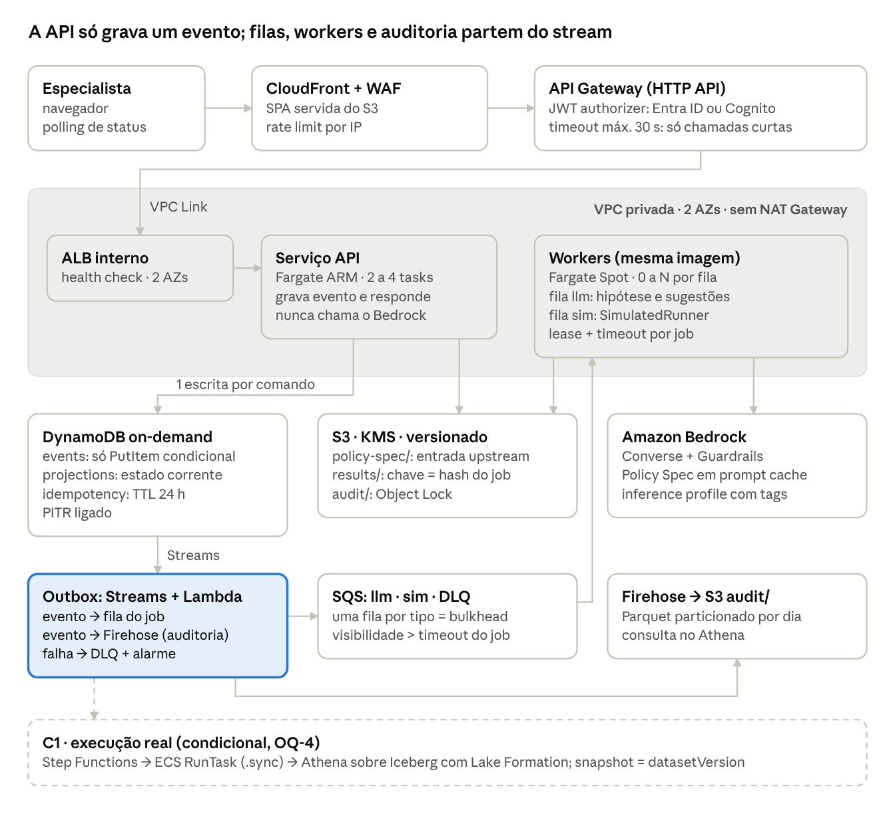
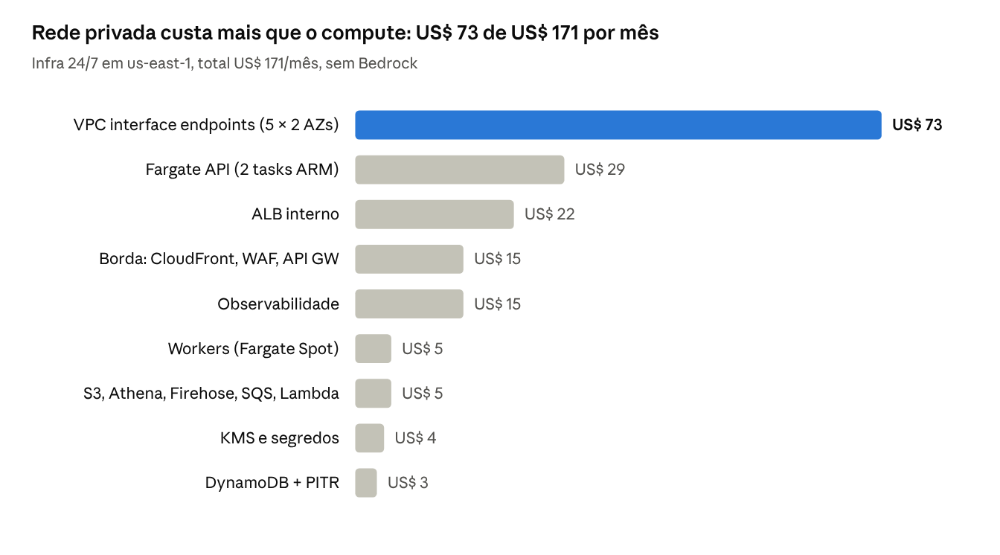

# Policy Playground — Arquitetura AWS (resiliência e custo)

Oct 15, 2026 · @Jaque Laurenti

> **Documento histórico.** Esta é a primeira análise do SDD (15/10). A arquitetura vigente, com os ajustes posteriores (Pipes no lugar da Lambda do outbox, 7 endpoints, 18 ADRs, cotas e retenção), está em [arquitetura-da-aplicacao.md](arquitetura-da-aplicacao.md).

## 1. Análise crítica do SDD

O design 1.2 é forte no domínio e fraco no plano de execução: as invariantes de evidência estão certas, mas há nove gaps de resiliência e custo que aparecem só quando o §16 é levado a sério como arquitetura de produção.

**O que manter sem discussão.** Separação IA × cálculo (D-4), avaliador fechado (D-6), cenário como overlay imutável (D-5), geradores determinísticos antes do modelo (D-10), evidenceLevel derivado de status+mode, execução assíncrona com polling (D-12), imagem única e backend stateless (D-11). Essas decisões já são, ao mesmo tempo, as melhores alavancas de FinOps: tudo que é determinístico não consome token.

| \#  | Gap                                                                                                     | Onde no SDD            | Consequência                                                                                                                | Correção proposta                                                                                                       |
|-----|---------------------------------------------------------------------------------------------------------|------------------------|-----------------------------------------------------------------------------------------------------------------------------|-------------------------------------------------------------------------------------------------------------------------|
| G1  | Timeout de integração do API Gateway HTTP API (30 s, não ajustável) é igual ao alvo P95 de estruturação | NFR Performance 2, §16 | Os 5% de chamadas mais lentas ao Bedrock viram 503 no gateway, sem resposta para o usuário                                  | Estruturação de hipótese também vira job assíncrono (mesmo contrato de §9.4)                                            |
| G2  | Dual write: DynamoDB e depois S3 de auditoria; DynamoDB e depois RunTask                                | §12, §9.4              | Queda da task entre as duas escritas perde evento de auditoria ou deixa job eterno em pending                               | Transactional outbox via DynamoDB Streams: uma escrita, o resto deriva do stream                                        |
| G3  | SimulatedRunner roda dentro da task da API                                                              | §9.4, §16              | Job morre com a task e fica em running; CPU do runner disputa com requisições (contradiz NFR Scalability 3)                 | Plano de workers separado, alimentado por fila, com lease e timeout                                                     |
| G4  | Idempotência de requisição e memoização de resultado tratadas como uma coisa só                         | §9.4, §14              | Corrida entre duas requisições iguais executa duas vezes; resultado real pode passar de 400 KB (limite de item do DynamoDB) | Dois mecanismos: header Idempotency-Key com TTL + cache de resultado endereçado por conteúdo no S3, com put condicional |
| G5  | “Append-only” convive com estado mutável (jobState, currentExecutionId, investigationState)             | §6.2, §12              | A garantia de imutabilidade não é verificável por IAM                                                                       | Tabela de eventos só com PutItem condicional + projeções mutáveis em outra tabela                                       |
| G6  | Rede não especificada: Fargate privado precisa de NAT ou VPC endpoints                                  | §16                    | Custo oculto de US\$ 65–90/mês, maior que o próprio compute                                                                 | Sem NAT: gateway endpoints (S3, DynamoDB) + interface endpoints mínimos                                                 |
| G7  | Monólito sem bulkhead por dependência                                                                   | D-1, §16               | Bedrock lento (dezenas de segundos) esgota conexões e degrada polling e CRUD de todos                                       | Limite de concorrência por dependência + circuit breaker que liga o modo degradado da NFR Reliability 2                 |
| G8  | FinOps limitado a cap por sessão; sem modelo de custo                                                   | §12, §16               | O custo dominante (tokens) não tem alavanca além de “chamar menos”                                                          | Prompt caching do Policy Spec, model tiering, application inference profiles com tags                                   |
| G9  | Região e residência de dados não decididas                                                              | §16                    | sa-east-1 custa mais e tem menos modelos; cross-region inference pode tirar dados do país                                   | Decisão explícita por ambiente (ADR-08)                                                                                 |

Dois pontos menores: o Cognito pode ser dispensável, porque o JWT authorizer do HTTP API valida tokens do Entra ID diretamente; e datasetVersion é opaco hoje, quando um snapshot Iceberg daria reprodutibilidade (R14.6) de graça para o C1.

## 2. Arquitetura-alvo AWS

A arquitetura mantém as decisões do time (ECS Fargate, DynamoDB, S3 + Athena, Bedrock) e muda uma coisa estrutural: a API vira um plano de comando que só grava eventos, e tudo que é lento ou falha (IA, execução, auditoria) roda fora dela, derivado do stream.

arquitetura-alvo · MVP + condicional C1

O caminho síncrono termina na gravação do evento no DynamoDB; o stream alimenta filas, workers e a trilha de auditoria, e o navegador acompanha por polling, como já previa o D-DQ4.

| Plano                 | Serviços                                                                                                 | Decisão e motivo                                                                                                                                                             |
|-----------------------|----------------------------------------------------------------------------------------------------------|------------------------------------------------------------------------------------------------------------------------------------------------------------------------------|
| Borda                 | CloudFront + WAF, S3 (SPA), API Gateway HTTP API                                                         | Custo por requisição, throttling por rota. O limite de 30 s do HTTP API passa a ser regra de design: nenhuma rota espera IA ou execução                                      |
| Identidade            | JWT authorizer validando Entra ID direto; Cognito federado só se a federação OIDC não for aprovada       | R15.4 sem um serviço a mais no caminho. Papéis R15.6 vêm do claim de grupos e são checados na API                                                                            |
| Comando (síncrono)    | ECS Fargate ARM (Graviton), 2 tasks em 2 AZs, ALB interno                                                | D-Q7. ARM custa cerca de 20% menos por vCPU-hora que x86 no Fargate. A API valida, grava evento e devolve jobId                                                              |
| Execução (assíncrona) | Workers da mesma imagem em Fargate Spot, escalados pela profundidade de cada fila SQS                    | Mantém D-1 (uma imagem). Spot é seguro porque todo job é idempotente e tem lease. Fila llm com mínimo 1 task no horário comercial, para não pagar cold start na estruturação |
| Estado                | DynamoDB on-demand: events, projections, idempotency                                                     | D-Q8, separando o que é imutável do que é estado corrente (G5)                                                                                                               |
| Resultados            | S3 com chave = hash do job (cache endereçado por conteúdo)                                               | Remove o limite de 400 KB do item e torna o reuso de NFR FinOps 3 um HeadObject                                                                                              |
| Auditoria             | DynamoDB Streams → Lambda → Firehose → S3 com Object Lock (modo governance) → Athena                     | D-Q9 sem dual write. O papel da aplicação não tem nenhuma permissão no prefixo audit/                                                                                        |
| IA                    | Bedrock Converse + Guardrails, prompt caching do Policy Spec, application inference profiles com tags    | Custo dominante do sistema (seção 4)                                                                                                                                         |
| Rede                  | Sem NAT. Gateway endpoints S3 e DynamoDB; interface endpoints ECR (api, dkr), Logs, Bedrock Runtime, SQS | Nenhum egress para a internet, o que também simplifica a aprovação de segurança                                                                                              |
| Execução real (C1)    | Step Functions Standard → ECS RunTask .sync → Athena sobre Iceberg, governado por Lake Formation         | Retry, timeout e catch nativos; o snapshot Iceberg vira o datasetVersion e dá reprodutibilidade (R14.6)                                                                      |
| Operação              | AWS CDK, CloudWatch, X-Ray, AWS Budgets                                                                  | Um stack por ambiente, como no §16                                                                                                                                           |

## 3. Padrões de resiliência

Seis padrões fecham os gaps G1 a G7, e cada falha passa a ter um modo degradado declarado; em nenhum deles o sistema substitui um resultado por estimativa (R5.7).

### 3.1 Transactional outbox (G2)

1.  O handler grava com TransactWriteItems: o evento em events (condição attribute_not_exists) e a atualização em projections. Nenhuma outra escrita acontece na requisição.

2.  O DynamoDB Stream (NEW_IMAGE) aciona uma Lambda que envia eventos de job para a fila SQS do tipo certo e todos os eventos para o Firehose.

3.  A Lambda usa BisectBatchOnFunctionError, 3 tentativas e destino de falha em uma DLQ. O alarme principal é IteratorAge acima de 60 s.

4.  O stream retém 24 h. Esse é o prazo para corrigir uma falha do pipeline antes de perder auditoria, e por isso o alarme dispara em minutos, não em horas.

O Firehose entrega *at-least-once*: um evento pode aparecer duas vezes no lake. A deduplicação acontece na leitura, com uma view no Athena por eventId. Isso corrige a afirmação do §12 de que o retry gera a mesma chave de objeto, que não vale para objetos agregados pelo Firehose.

### 3.2 Job com lease e timeout (G1, G3)

1.  Estruturação de hipótese, sugestões e execução simulada viram jobs. A API devolve 202 com jobId em milissegundos; o limite de 30 s do gateway deixa de importar.

2.  O worker recebe a mensagem e faz update condicional pending → running com leaseUntil = agora + timeout e attempt + 1. Outro worker só retoma o job se o lease expirou.

3.  Durante jobs longos, o worker estende a visibilidade da mensagem e o lease (heartbeat).

4.  Ao terminar, grava o resultado em results/{hash} com If-None-Match: \* (escrita condicional do S3) e emite ExecutionCompleted.

5.  Interrupção do Fargate Spot (aviso de 2 min): o worker para de consumir e devolve a mensagem com visibilidade 0.

6.  Após maxReceiveCount = 3, a mensagem vai para a DLQ e um reconciliador grava status = cannot_calculate.

### 3.3 Idempotência em dois níveis (G4)

| Nível      | Chave                                                                     | Onde                                                                                | Garante                                                                         |
|------------|---------------------------------------------------------------------------|-------------------------------------------------------------------------------------|---------------------------------------------------------------------------------|
| Requisição | Header Idempotency-Key gerado pelo cliente                                | Tabela idempotency, TTL 24 h, guarda a resposta original                            | NFR Reliability 3: retry não duplica hipótese, execução ou decisão              |
| Computação | sha256(policyVersion, overrides canônicos, datasetVersion, runnerVersion) | HeadObject em results/{hash}; item job#{hash} com put condicional para o job em voo | NFR FinOps 3 e R14.6: um cálculo por entrada, mesmo com requisições simultâneas |

Se o objeto existe, o resultado é reaproveitado sem compute. Se há job em voo com o mesmo hash, a nova requisição se anexa a ele. Falhas (cannot_calculate) não entram em results/, então podem ser tentadas de novo.

### 3.4 Log de eventos separado do estado corrente (G5)

events (PK investigationId, SK seq#eventId) recebe só PutItem condicional. O papel da aplicação tem Deny explícito para UpdateItem, DeleteItem e BatchWriteItem nessa tabela. jobState, currentExecutionId e investigationState vivem em projections, que é mutável e reconstruível a partir dos eventos.

O IAM não consegue forçar a condição do PutItem; um bug ainda poderia sobrescrever um evento. Por isso a garantia forte de imutabilidade fica no S3 com Object Lock, e a do DynamoDB é operacional.

### 3.5 Bulkhead, timeout e circuit breaker (G7)

- A API não tem cliente do Bedrock. Um Bedrock lento não consome conexões nem threads da API.

- Cada fila é um compartimento: llm e sim têm workers, concorrência e escala próprios.

- No worker llm: timeout de cliente, SDK em modo de retry adaptativo, no máximo 2 tentativas com jitter.

- Circuit breaker: quando a taxa de erro ou throttling do Bedrock passa de um limite configurável, um flag no AWS AppConfig faz a API responder “IA temporariamente indisponível” sem enfileirar (NFR Reliability 2).

- O health check do ALB testa só o processo. Dependências fora do ar não derrubam tasks saudáveis em cascata.

### 3.6 Estabilidade estática e deploy seguro

- Policy Spec é imutável por (policyId, objectVersion): a validação roda uma vez, na chegada ao S3 (evento do S3 → validador), e grava um manifesto. A API carrega o manifesto e mantém o modelo em cache sem expiração.

- ECS com deployment circuit breaker e rollback automático, mínimo de 100% saudável durante o deploy.

### 3.7 Matriz de falhas

| Falha                               | Detecção                              | Comportamento                                                            | Continua funcionando                                |
|-------------------------------------|---------------------------------------|--------------------------------------------------------------------------|-----------------------------------------------------|
| Task da API cai                     | Health check do ALB; ECS repõe a task | Requisições em voo falham; o cliente reenvia com a mesma Idempotency-Key | Tudo                                                |
| Uma AZ inteira                      | ALB remove alvos; ECS rebalanceia     | Capacidade cai à metade até a reposição; endpoints existem nas 2 AZs     | Tudo                                                |
| Bedrock lento ou fora               | Circuit breaker                       | Linguagem natural e sugestões desligadas com aviso                       | Exploração, edição visual, G1/G2, execução, decisão |
| Worker morre ou Spot é interrompido | Lease expira; SIGTERM                 | Job volta para a fila; resultado já gravado é reaproveitado pelo hash    | Tudo, com atraso                                    |
| Job esgota tentativas               | DLQ                                   | Reconciliador grava cannot_calculate                                     | Resto do sistema                                    |
| Lambda do outbox falha              | IteratorAge, DLQ                      | Eventos aguardam no stream por até 24 h                                  | API grava; jobs e auditoria atrasam                 |
| Firehose ou S3 de auditoria         | Métricas de entrega do Firehose       | Firehose tenta de novo; nada é perdido enquanto o stream retiver         | Tudo                                                |
| Região inteira                      | —                                     | Fora do escopo do MVP: CDK em outra região + restore de backup           | —                                                   |

### 3.8 RPO, RTO e SLOs propostos

| Dado                              | RPO               | RTO                          | Mecanismo                                                                       |
|-----------------------------------|-------------------|------------------------------|---------------------------------------------------------------------------------|
| Estado da investigação (DynamoDB) | Minutos           | Horas                        | PITR (restauração para qualquer segundo dos últimos 35 dias, em nova tabela)    |
| Auditoria (S3)                    | Zero após entrega | Não se aplica                | Versionamento + Object Lock; replicação entre regiões só se a governança exigir |
| Policy Spec                       | Zero              | Minutos                      | Versionado no S3; origem no Git upstream                                        |
| Resultados                        | Não se aplica     | Recalculável                 | Reproduzíveis pela chave (R14.6)                                                |
| Infraestrutura                    | —                 | Menos de 1 h na mesma região | AWS CDK                                                                         |

SLOs propostos para o time validar: API disponível 99,5% no horário comercial; estruturação com P95 de 30 s medido do envio até o resultado no polling (a leitura correta da NFR, já que o gateway não é mais o limite); auditoria com atraso P99 abaixo de 5 min.

## 4. Custos

A infraestrutura custa cerca de US\$ 171 por mês ligada 24/7; o Bedrock custa entre US\$ 40 e US\$ 2.390 por mês, conforme modelo e cache. A decisão de FinOps está nos tokens, não no Fargate.

estimativa com preços de lista us-east-1 · 730 h/mês · out/2026

Premissas da infra: API com 0,5 vCPU e 1 GB por task; workers com mínimo de 1 task só no horário comercial; polling com backoff. Fargate ARM a US\$ 0,0324 por vCPU-hora e US\$ 0,0036 por GB-hora ([AWS](https://aws.amazon.com/fargate/pricing/)); ALB a US\$ 0,0225 por hora ([Cloudburn](https://cloudburn.io/blog/aws-fargate-pricing)). Interface endpoint a US\$ 0,01 por hora por AZ e LCU do ALB a US\$ 0,008 são aproximados e precisam ser conferidos na calculadora. A alternativa com NAT Gateway em 2 AZs custa US\$ 66 por mês antes de tráfego (US\$ 0,045 por hora e por GB), praticamente o mesmo que os endpoints, mas com egress para a internet.

### 4.1 Bedrock: o custo que importa

| Cenário                                         | Modelo                 | US\$ por hipótese | US\$ por mês |
|-------------------------------------------------|------------------------|-------------------|--------------|
| Sem cache                                       | Claude Sonnet 4.5      | 0,22              | 2.390        |
| Sem cache                                       | Claude Sonnet 5.5      | 0,15              | 1.600        |
| Cache do Policy Spec                            | Claude Sonnet 5.5      | 0,067             | 740          |
| Tiering + cache: Haiku estrutura, Sonnet sugere | Haiku 5.5 + Sonnet 5.5 | 0,039             | 430          |
| Tudo em Haiku + cache                           | Claude Haiku 5.5       | 0,0036            | 40           |

Premissas: 50 usuários × 10 hipóteses por dia × 22 dias = 11 mil hipóteses por mês; 55 mil tokens de entrada e 3,5 mil de saída por hipótese (estruturação + sugestões), dos quais 44 mil são prompt de sistema e Policy Spec, cacheáveis; sessões de cerca de 10 hipóteses. Preços de lista da [Anthropic](https://platform.claude.com/docs/en/about-claude/pricing?m=1); no Bedrock, endpoints regionais custam 10% a mais que os globais. O tamanho do Policy Spec real é a variável mais sensível: o fixture tem 12,6 KB, um real deve ser várias vezes maior.

### 4.2 Alavancas, em ordem de impacto

1.  **Modelo por tarefa, escolhido por eval.** A diferença entre extremos é de 60×. Montar um conjunto de avaliação a partir do fixture (parâmetro certo, pedido de esclarecimento quando ambíguo, R3.3) e usar o modelo mais barato que atinge a meta. Não assumir que o Haiku basta.

2.  **Prompt caching com prefixo estável.** Ordem fixa: sistema → Policy Spec → contexto da sessão → texto do usuário. Corta mais de 50% no Sonnet.

3.  **Determinístico primeiro.** Edição visual já é uma hipótese estruturada e não deve chamar o modelo; G1 e G2 não custam token.

4.  **Reuso por hash** de execução (seção 3.3) e cap de 10 findings por sessão (NFR FinOps 2).

5.  **Polling com backoff** (1, 2, 4 até 10 s) e só com job em voo: polling fixo de 3 s para 50 usuários gera da ordem de 8 milhões de requisições por mês na borda.

6.  **Ambientes não produtivos:** escala agendada para 0 fora do horário, endpoints em 1 AZ, stack destruído entre ciclos.

7.  **Visibilidade:** application inference profiles com tags por ambiente e time, tokens por hipótese no evento (como no §12) e AWS Budgets em 50, 80 e 100% com ação que liga o cap mais restritivo.

Savings Plans não compensam neste tamanho: o compute estável é de US\$ 29 por mês.

## 5. Decisões propostas e impacto no spec

Onze ADRs entram como revisão 1.3 do design.md; nenhuma contradiz uma decisão do time, mas três revisam alternativas que o §17 tinha descartado (SQS, Step Functions, workers separados).

| ADR    | Decisão                                                                                                                      | Revisa no design.md                                      | Gap    |
|--------|------------------------------------------------------------------------------------------------------------------------------|----------------------------------------------------------|--------|
| ADR-01 | API como plano de comando: estruturação, sugestões e execução viram jobs                                                     | §9.4 (SimulatedRunner na task da API), NFR Performance 2 | G1, G3 |
| ADR-02 | Transactional outbox via DynamoDB Streams para filas e auditoria                                                             | §12 (audit writer após o DynamoDB)                       | G2     |
| ADR-03 | Idempotência de requisição separada da memoização; resultados no S3 por hash                                                 | D-12, §9.4                                               | G4     |
| ADR-04 | Tabela events imutável e projections mutável                                                                                 | D-11, §6.2                                               | G5     |
| ADR-05 | Workers da mesma imagem em Fargate Spot, uma fila SQS por tipo de job                                                        | §16, §16.1, §17 (SQS)                                    | G3, G7 |
| ADR-06 | Step Functions + RunTask .sync para o C1                                                                                     | §17 (Step Functions)                                     | G3     |
| ADR-07 | VPC sem NAT, com gateway e interface endpoints                                                                               | §16                                                      | G6     |
| ADR-08 | us-east-1 no hackathon (dados sintéticos); sa-east-1 como alvo de produção se os modelos escolhidos rodarem sem sair do país | §16                                                      | G9     |
| ADR-09 | JWT authorizer direto no Entra ID; Cognito só como plano B                                                                   | §16 (Cognito SAML)                                       | —      |
| ADR-10 | Modelo por tarefa definido por eval; prompt caching obrigatório                                                              | §12 FinOps, §16                                          | G8     |
| ADR-11 | Datasets em Iceberg; snapshot id = datasetVersion                                                                            | §9.4, C1                                                 | —      |

Sobre o ADR-08: a documentação do Bedrock não lista quais modelos Claude têm inference profile partindo de sa-east-1, e o perfil Global não inclui São Paulo como origem ([AWS](https://docs.aws.amazon.com/bedrock/latest/userguide/inference-profiles-support.html)). A verificação é aws bedrock list-inference-profiles --region sa-east-1 seguida de get-inference-profile para ver as regiões de destino, antes de qualquer promessa de residência de dados.

### 5.1 Mudanças no tasks.md

| Task        | Mudança                                                                                                                                                                     |
|-------------|-----------------------------------------------------------------------------------------------------------------------------------------------------------------------------|
| 7.2         | Incluir lease, heartbeat, idempotência em dois níveis e resultados em results/{hash}                                                                                        |
| 7.3 (nova)  | Serviço de workers e filas llm, sim e DLQs, com reconciliador para cannot_calculate                                                                                         |
| 9.3         | Trocar o audit writer pelo pipeline Streams → Lambda → Firehose; view de deduplicação por eventId no Athena                                                                 |
| 10          | Estruturação como job assíncrono; P95 de 30 s medido do envio ao resultado                                                                                                  |
| 18          | Circuit breaker via AppConfig; Budgets com ação; tags nos inference profiles                                                                                                |
| 21          | CDK com endpoints sem NAT, workers, SQS, Lambda do stream, Firehose e Object Lock                                                                                           |
| 22.1 (nova) | Conjunto de eval sobre o fixture e escolha de modelo por tarefa                                                                                                             |
| 24          | Testes de falha com AWS FIS: parar worker no meio do job, simular interrupção Spot, desligar a Lambda do outbox por 10 min e provar que nenhum evento de auditoria se perde |
| C1          | Step Functions + RunTask + Athena sobre Iceberg com Lake Formation                                                                                                          |

### 5.2 Perguntas para o time

- [ ] Qual é o tamanho de um Policy Spec real? É a variável que mais move o custo do Bedrock.

- [ ] Quantas hipóteses por especialista por dia? A estimativa usa 10.

- [ ] A segurança aprova federação OIDC do Entra ID direto no API Gateway?

- [ ] O ambiente do hackathon pode ficar em us-east-1?

### Fontes

- [Quotas do HTTP API no API Gateway](https://docs.aws.amazon.com/apigateway/latest/developerguide/http-api-quotas.html)

- [Regiões e modelos com inference profiles no Bedrock](https://docs.aws.amazon.com/bedrock/latest/userguide/inference-profiles-support.html)

- [Preços dos modelos Claude](https://platform.claude.com/docs/en/about-claude/pricing?m=1)

- [Preços do AWS Fargate](https://aws.amazon.com/fargate/pricing/)

- [Custos ocultos do Fargate (Cloudburn)](https://cloudburn.io/blog/aws-fargate-pricing)

- [Spec do Policy Playground](https://github.com/Jaquelaurenti/policy-playground-spec/tree/main)
