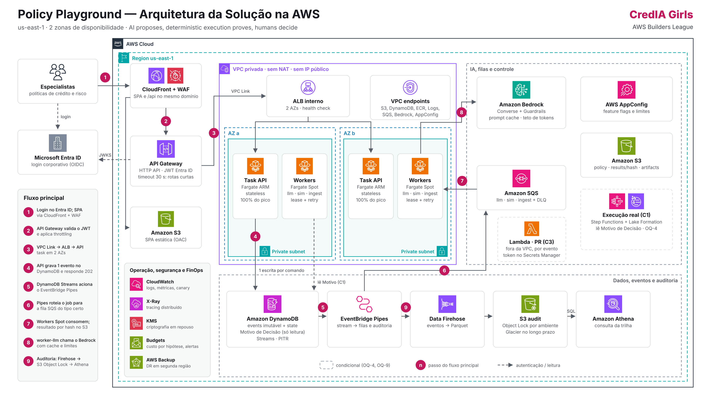
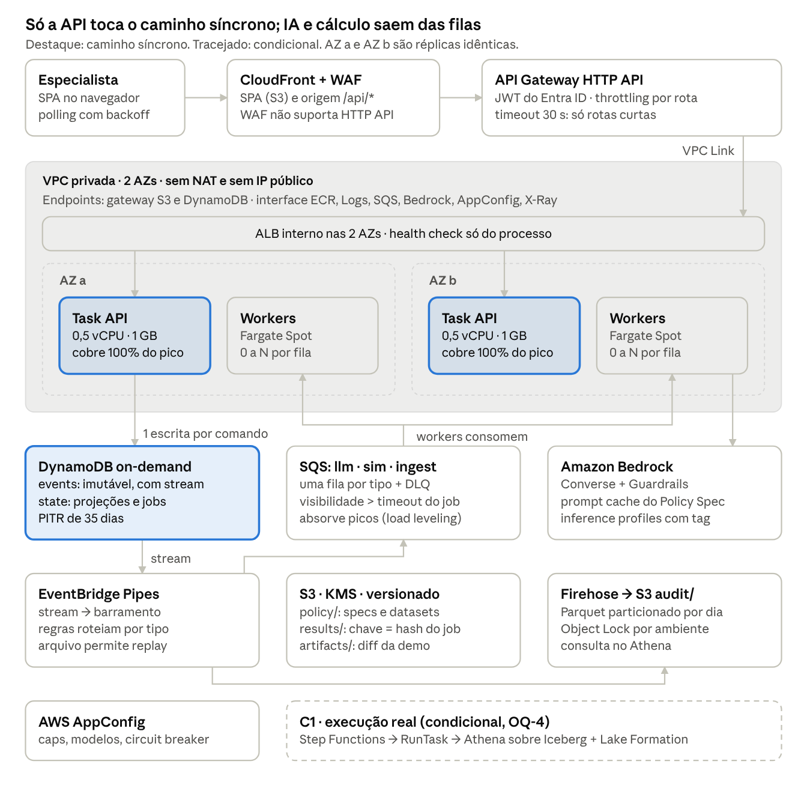
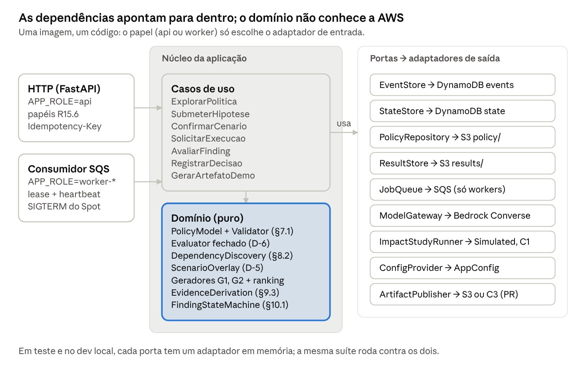
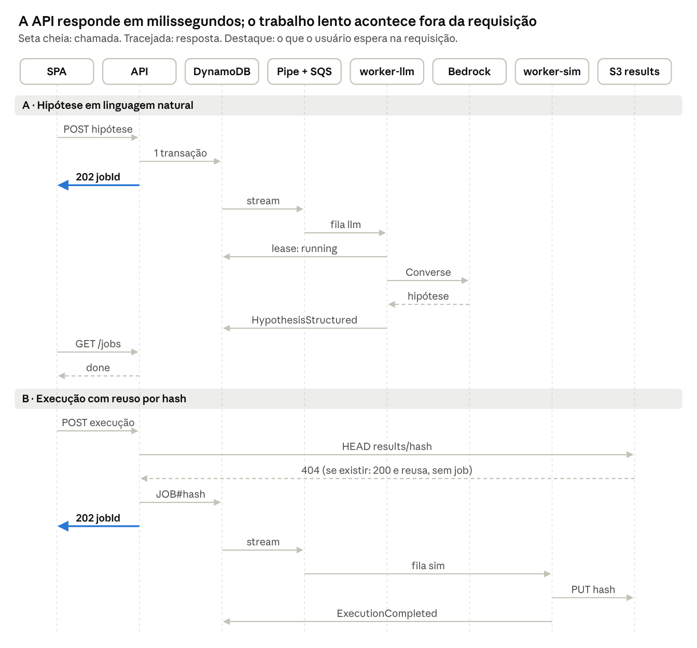
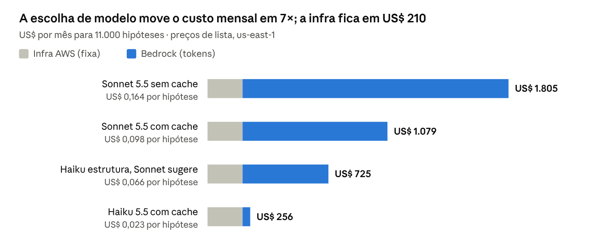

# Policy Playground — Arquitetura da Aplicação

Oct 20, 2026 · @Jaque Laurenti



> Entregáveis relacionados: [vídeo explicativo](video/CredIA-Girls_Policy-Playground_Arquitetura.mp4) · [simulador de teste de mesa](simulador/teste-de-mesa.html) · [análise inicial do SDD](analise-sdd-arquitetura-aws.md)

A aplicação é um monólito modular em uma única imagem ARM. Ela roda em dois papéis: uma API de comando, síncrona e sempre ligada em 2 AZs, e workers assíncronos em Fargate Spot, alimentados por filas. Com 50 usuários, a infraestrutura custa cerca de US$ 210 por mês, e o custo que decide é o do Bedrock: de US$ 46 a US$ 1.595 por mês, conforme o modelo e o uso de cache.

## 1. Direcionadores e princípios

Sete requisitos do spec decidem a forma da arquitetura; o restante cabe em qualquer desenho razoável.

| Direcionador (spec) | O que exige | Decisão de arquitetura |
| --- | --- | --- |
| NFR Scalability 1–3 | 10 a 50 usuários, backend sem estado, execução longa isolada das requisições | API sem estado + workers separados por fila |
| NFR Performance 2 | Hipótese estruturada em até 30 s no P95 | Estruturação como job assíncrono: o timeout de 30 s do API Gateway HTTP API não pode ser ajustado |
| NFR Reliability 2 | Sem o modelo de IA, exploração, execução e decisão continuam funcionando | O Bedrock fica fora do caminho síncrono, atrás de um circuit breaker |
| NFR Reliability 3, FinOps 3 | Retry não duplica; entrada repetida reaproveita o resultado | Idempotência por requisição + cache de resultado endereçado por hash |
| R14.4–14.6 | Histórico persistido, auditoria append-only, resultados reproduzíveis | Log de eventos imutável; auditoria derivada do stream, sem escrita dupla |
| NFR FinOps 1–2 | Custo de inferência limitado por hipótese e sessão | Orçamento de tokens no app, cache de prompt, modelo por tarefa |
| D-Q5 a D-Q9 | ECS Fargate, Entra ID, DynamoDB, S3 + Athena, Bedrock | Mantidas como premissas |

**Princípios.**

1. **O caminho síncrono só grava e lê.** Nenhuma rota espera IA ou cálculo. A disponibilidade da API não depende do Bedrock.
2. **Determinístico antes de probabilístico.** Edição visual, descoberta de dependências e os geradores G1 e G2 não chamam o modelo. Isso é regra de produto (D-4, D-10) e também a maior alavanca de custo.
3. **Uma escrita por comando.** Filas, auditoria e métricas derivam do stream do log de eventos.
4. **Toda unidade de trabalho é idempotente.** Isso torna seguros o retry, o Fargate Spot e a perda de uma AZ.
5. **Estabilidade estática.** A capacidade de uma AZ sozinha cobre o pico, e nenhuma dependência de plano de controle participa da recuperação.
6. **Custo como requisito.** Toda chamada ao modelo tem dono, tag e orçamento.

## 2. Visão de containers

Todos os componentes rodam em uma região, em 2 AZs. A API grava um evento por comando no DynamoDB; o stream leva esse evento às filas e à auditoria, e os workers fazem o trabalho lento.



O caminho síncrono destacado depende só de borda, API e DynamoDB. Bedrock, filas e auditoria podem falhar sem tirar a API do ar.

| Unidade | Runtime | Escala | Faz | Não faz |
| --- | --- | --- | --- | --- |
| `web` | SPA (React + Vite) em S3 + CloudFront | Borda | Exploração, editor what-if, badges de evidência, polling | Nenhuma regra de negócio |
| `api` | Imagem única, `APP_ROLE=api`, Fargate ARM sob demanda | 2 a 6 tasks, por requisições e CPU | Autoriza, valida, grava eventos, responde leituras e `GET /jobs/{id}` | Chamar o Bedrock ou executar regras |
| `worker-llm` | Mesma imagem, `APP_ROLE=worker-llm`, Fargate Spot | 0 a N pela fila, com teto pela cota do Bedrock | Estruturação de hipótese, ranking e redação de sugestões | Produzir números de impacto |
| `worker-sim` | Mesma imagem, `APP_ROLE=worker-sim`, Fargate Spot | 0 a N pela fila | `SimulatedRunner` sobre o fixture sintético, geradores G1 e G2, artefato de diff | Chamar o modelo; ler o Motivo de Decisão no MVP (ADR-17) |
| `worker-ingest` | Mesma imagem, `APP_ROLE=worker-ingest`, Fargate Spot | 0 a 1 | Validar Policy Spec, extensions e dataset na chegada ao S3; gravar o manifesto; marcar o contexto de domínio como desatualizado quando o commit dele é anterior ao da política (R13) | Alterar o Policy Spec |
| Pipe + barramento | EventBridge Pipes e regras | Gerenciado | Rotear eventos do stream para filas, Firehose e a Lambda de PR | Lógica de negócio |
| `pr-publisher` (C3) | AWS Lambda fora da VPC, acionada pelo evento `ChangeArtifactSelected`; token do Git no Secrets Manager | Por evento | Abrir o PR real de revisão no repositório SYN e registrar o link (R12) | Merge ou deploy; entra só se a OQ-9 confirmar o acesso (ADR-18) |
| `runner-real` (C1) | Step Functions → ECS RunTask da mesma imagem | Por execução | Estudo real e comparação com o `Motivo de Decisão` (ADR-17) | Entra só se a OQ-4 for resolvida |

O WAF fica no CloudFront porque o AWS WAF não se associa a APIs HTTP do API Gateway ([AWS re:Post](https://repost.aws/questions/QUXjJnNPjoRgqgwSs-5jbMjw/aws-waf-for-http-apis)). A SPA e a API ficam no mesmo domínio, o que também elimina CORS.

## 3. Arquitetura interna

O código segue portas e adaptadores: o domínio implementa as invariantes do spec sem depender da AWS, e cada recurso externo entra por uma porta. Assim, o MVP roda sobre o fixture e troca o `SimulatedRunner` pelo C1 sem tocar no núcleo, como pede o D-3.



As regras que sustentam a confiança no produto (avaliador fechado, `evidenceLevel` derivado, IA sem números) ficam no domínio e são testadas sem rede. Stack sugerida, que o design deixou em aberto: Python 3.12 com FastAPI e Pydantic no backend, React com React Flow para o DAG na SPA.

**Regras de dependência, verificadas no CI.**

- O domínio não importa `boto3`, FastAPI nem nenhum adaptador. Um teste de arquitetura (import-linter) quebra o build se isso mudar.
- Só o papel `worker-llm` tem o adaptador `ModelGateway` e a permissão IAM `bedrock:InvokeModel`. A API não consegue chamar o modelo nem por engano.
- Nenhum papel tem permissão de escrita no prefixo `audit/`. A trilha só chega lá pelo Firehose.
- Resultado de execução só é gravado pelo `ImpactStudyRunner`. A saída do modelo vai para outro tipo de registro (`source = ai_suggestion`).

### 3.1 Contrato da API

Toda rota que muda estado exige o header `Idempotency-Key`. Rotas assíncronas devolvem `202` com `jobId`, e o cliente acompanha por `GET /jobs/{id}`.

| Rota | Papel mínimo | Resposta | Observação |
| --- | --- | --- | --- |
| `GET /policies`, `GET /policies/{id}/versions/{v}` | Viewer | 200 | Modelo derivado, relatório de validação e aviso de contexto desatualizado (R13); imutável por versão (`Cache-Control: private, immutable`) |
| `POST /investigations` | Policy Specialist | 201 | Vincula a `policyVersion` e `datasetVersion` |
| `POST /investigations/{id}/hypotheses` | Policy Specialist | 201 (visual) ou 202 (linguagem natural) | A edição visual já é estruturada e não chama o modelo |
| `POST /hypotheses/{id}/confirm` | Policy Specialist | 201 | Cria o cenário (R4); aceita a versão editada pelo especialista |
| `POST /scenarios/{id}/executions` | Policy Specialist | 202, ou 200 se o hash já tem resultado | Reuso pela chave de idempotência (D-12) |
| `GET /jobs/{id}` | Dono da investigação | 200 | `jobState`, `attempt`, link para o resultado |
| `GET /investigations/{id}/findings` | Viewer | 200 | Ranqueados, limitados ao cap da sessão; os demais sob pedido (NFR FinOps 2) |
| `POST /findings/{id}/assessment` | Policy Specialist | 201 | Relevante ou irrelevante (R8.4); atualiza os contadores `REL#` |
| `POST /findings/{id}/scenario` | Policy Specialist | 201 | Finding vira cenário, sem execução automática (OQ-8) |
| `POST /hypotheses/{id}/decisions` | Policy Specialist ou Risk Approver | 201 | Accept, Reject ou Defer; `supersedes` opcional (R10.5–10.6) |
| `POST /scenarios/{id}/selection` | Policy Specialist | 201 | Seleção explícita para o artefato de mudança (R10.2–10.3); exige decisão Accept vigente |
| `POST /scenarios/{id}/change-artifact` | Policy Specialist | 202 | Diff e testes de demonstração, rotulados (R11); recusado sem seleção |
| `GET /investigations/{id}/executions` | Data Analyst | 200 | Execuções com `policyVersion`, overrides, `datasetVersion` e `runnerVersion` para reproduzir (R14.6) |
| `GET /investigations/{id}/audit` | Risk Approver | 200 | Lê a trilha pelo Athena |

Além do papel, toda rota que toca uma política confere a ACL `POLICY#{id}/ACL` contra os grupos do token. Uma política sem acesso responde `403`, nunca lista vazia (R15.3). O `runnerVersion` é o digest da imagem do container, o que torna a reprodução exata.

## 4. Fluxo assíncrono

Toda operação lenta segue o mesmo contrato de job: a API grava e devolve `202` em milissegundos, um worker assume o job com lease, e a SPA acompanha por polling com backoff (1, 2, 4 até 10 s).



Na fase B, uma entrada repetida não gera job: o `HEAD` encontra o resultado e a API responde `200`. Duas requisições simultâneas com o mesmo hash disputam o put condicional de `JOB#hash`; a segunda se anexa ao job da primeira.

**Estados do job.** `pending → running → done`, com `status` em `ok`, `validated`, `executed_unvalidated`, `validation_failed` ou `cannot_calculate`, como no §9.4 do design.

| Mecanismo | Regra |
| --- | --- |
| Lease | O worker grava `leaseUntil = agora + timeout` com update condicional. Outro worker só assume o job depois que o lease expira |
| Heartbeat | Em jobs longos, o worker estende o lease e a visibilidade da mensagem a cada metade do timeout |
| Spot | No SIGTERM (2 min de aviso), o worker para de consumir e devolve a mensagem com visibilidade 0 |
| Retry | `maxReceiveCount = 3`; depois disso, DLQ, e um reconciliador grava `cannot_calculate` (R5.7) |
| Timeouts | `worker-llm`: 60 s por chamada, 2 tentativas com jitter. `worker-sim`: configurável por runner |
| Resultado | `PUT results/{hash}` com `If-None-Match: *`. A primeira escrita vence e o resultado nunca é sobrescrito (R14.6) |

## 5. Dados

Duas tabelas DynamoDB separam o que é imutável do que muda; a separação existe para o IAM conseguir negar update e delete no log de eventos. Payloads grandes ficam no S3, e o DynamoDB guarda só a referência.

### 5.1 `pp-events` (imutável, com stream)

| Chave | Formato | Uso |
| --- | --- | --- |
| PK | `INV#{investigationId}` | Toda a história de uma investigação em uma partição |
| SK | `EVT#{seq com 10 dígitos}` | Ordem total por investigação |
| Atributos | `eventId`, `type`, `actor`, `occurredAt`, `schemaVersion`, `payload` ou `payloadRef` | `payloadRef` aponta para o S3 quando o payload passa de 100 KB |

O `seq` dá controle de concorrência otimista. A mesma `TransactWriteItems` grava o evento com `attribute_not_exists(SK)` e atualiza `lastSeq` na projeção com a condição `lastSeq = seq - 1`. Duas abas do mesmo usuário não conseguem gravar eventos conflitantes; a segunda recebe `409` e recarrega.

### 5.2 `pp-state` (projeções, jobs e controle)

| PK | SK | Conteúdo | TTL |
| --- | --- | --- | --- |
| `INV#{id}` | `META` | Dono, `policyVersion`, `datasetVersion`, `lastSeq`, status | — |
| `INV#{id}` | `HYP#{id}`, `SCN#{id}`, `FND#{id}`, `EXE#{id}`, `DEC#{id}`, `SEL#{id}` | Estado corrente de cada entidade (`investigationState`, `currentExecutionId`, seleção explícita) | — |
| `SESSION#{id}` | `META` | Findings mostrados, chamadas ao modelo e tokens da sessão (NFR FinOps 2) | 7 dias |
| `JOB#{hash}` | `META` | `jobState`, `leaseUntil`, `attempt`, `resultKey` | 7 dias após `done` |
| `IDEM#{userId}#{key}` | `META` | Resposta original da requisição | 24 h |
| `BUDGET#{userId}#{dia}` | `META` | Tokens e chamadas ao modelo no dia (`ADD` atômico) | 3 dias |
| `REL#{policyId}` | `KIND#{tipo}` (G1, G2 ou ai\_suggestion) | Contadores `relevant` e `assessed` usados no ranking (R8.6) | — |
| `POLICY#{id}` | `VER#{objectVersion}` | Manifesto validado, `source_commit`, relatório de validação, frescor do contexto de domínio (R13) | — |
| `POLICY#{id}` | `ACL` | Grupos do Entra ID que podem ver a política e seus datasets (R15.3) | — |

Um GSI (`GSI1PK = OWNER#{userId}`, `GSI1SK = updatedAt`) atende "minhas investigações". As projeções podem ser reconstruídas a partir de `pp-events`; por isso a `pp-state` não precisa de backup próprio além do PITR.

### 5.3 `Motivo de Decisão` (tabela existente)

O `Motivo de Decisão` já está em uma tabela DynamoDB desta arquitetura. O Playground só lê essa tabela e nunca escreve nela; ela é a base de comparação entre o baseline e o cenário (R5.1).

| Tema | Regra |
| --- | --- |
| Quem lê | Só o runner real do C1, com `Query`, `GetItem` e `BatchGetItem` (ADR-17). No MVP, o `worker-sim` usa apenas o fixture sintético. Deny explícito de escrita para todos os papéis do Playground |
| Quem nunca lê | API, `worker-llm` e Bedrock. Nenhuma linha vai para o modelo (R15.2); a IA só vê agregados já calculados |
| Padrão de acesso | `Query` por `datasetVersion` e shard, nunca `Scan`. Se a chave atual não permitir, um GSI `DS#{datasetVersion}#{shard}` resolve sem mexer na tabela |
| Isolamento de carga | Concorrência de leitura limitada pela flag `limits.motivo_read_concurrency`, para o Playground não competir com os outros consumidores da tabela |
| Reprodutibilidade (R14.6) | O `datasetVersion` precisa apontar para um estado fixo. Se a tabela é carregada por lote, os itens carregam a versão e nunca são reescritos; se ela muda continuamente, a execução lê um export point-in-time para o S3, que não consome capacidade da tabela |
| Privacidade (R15.5) | A tabela precisa conter dados anonimizados ou sintéticos. Se tiver dados reais de clientes, o Playground lê um export anonimizado, não a tabela |
| Resultado | A execução grava em `results/{hash}` os agregados comparados e a referência do `datasetVersion`, nunca as linhas lidas |

Como o `datasetVersion` entra na chave de idempotência, o reuso por hash faz cada combinação de cenário e dataset ler a tabela uma única vez.

### 5.4 S3

| Bucket e prefixo | Conteúdo | Proteção | Ciclo de vida |
| --- | --- | --- | --- |
| `pp-policy/specs/` | Policy Spec, extensions e datasets sintéticos | Versionamento; escrita só pelo pipeline upstream | Versões antigas para Glacier Instant Retrieval após 90 dias |
| `pp-data/results/` | Resultados por hash, imutáveis | Put condicional; sem `DeleteObject` para a aplicação | Intelligent-Tiering |
| `pp-data/artifacts/` | Diff e testes de demonstração | Versionamento | Expira em 180 dias |
| `pp-audit/` | Eventos em Parquet, particionados por `dt=` | Object Lock em compliance na produção e governance em estudos; só o Firehose escreve | Retenção por ambiente (seção 9.4): anos em produção, parametrizável em estudos |
| `pp-web/` | Build da SPA | Origin Access Control do CloudFront | Versões antigas expiram em 30 dias |

Todos os buckets usam SSE-KMS com S3 Bucket Keys, o que reduz as chamadas ao KMS e o custo delas.

## 6. Alta disponibilidade

O SLO proposto para a API é 99,5% ao mês. Pelos SLAs da AWS, a cadeia síncrona chega a 99,82%, e a diferença fica como margem de erro para deploys e bugs nossos. Prometer 99,9% exigiria tirar serviços da cadeia em série ou ir para multirregião, o que não se justifica para 50 usuários.

### 6.1 Disponibilidade composta do caminho síncrono

Serviços em série multiplicam suas disponibilidades:

```latex
A = A_{CloudFront} \times A_{API\,GW} \times A_{ALB} \times A_{ECS} \times A_{DynamoDB} = 0{,}999 \times 0{,}9995 \times 0{,}9999^{3} \approx 99{,}82\%
```

| Componente | SLA mensal | Fonte |
| --- | --- | --- |
| CloudFront | 99,9% | [SLA CloudFront](https://aws.amazon.com/cloudfront/sla/) |
| API Gateway | 99,95% | [SLA API Gateway](https://aws.amazon.com/api-gateway/sla/) |
| ALB em 2 ou mais AZs | 99,99% | [SLA ELB](https://aws.amazon.com/elasticloadbalancing/sla/) |
| ECS/Fargate em 2 ou mais AZs | 99,99% | [SLA ECS](https://aws.amazon.com/ecs/sla/) |
| DynamoDB, tabela padrão | 99,99% | [SLA DynamoDB](https://aws.amazon.com/dynamodb/sla/) |
| Bedrock (fora da cadeia) | Créditos abaixo de 99,9% | [SLA Bedrock](https://aws.amazon.com/bedrock/sla/) |

Se o Bedrock estivesse no caminho síncrono, a conta cairia para 99,72%, cerca de 2 horas de indisponibilidade por mês. Tirar a IA da requisição é a decisão de HA de maior efeito neste desenho. SLAs são compromissos de crédito, não medições; a disponibilidade real costuma ser maior, e o SLO deve ser medido por canary sintético (CloudWatch Synthetics) a cada 5 minutos.

### 6.2 Estabilidade estática por AZ

- **API:** 2 tasks, uma por AZ, cada uma dimensionada para 100% do pico (50 usuários cabem com folga em 0,5 vCPU). Se uma AZ cai, não há perda de capacidade nem dependência de escalar durante o incidente.
- **Distribuição:** subnets nas 2 AZs, ALB com cross-zone, endpoints de interface nas 2 AZs e rebalanceamento de AZ ligado no serviço ECS.
- **`worker-llm`:** estratégia de capacidade com base de 1 task em Fargate sob demanda no horário comercial e o restante em Spot. Falta de Spot não quebra o P95 de 30 s da estruturação.
- **`worker-sim` e `worker-ingest`:** 100% Spot. Atraso é aceitável e o job é retomado pelo lease.
- **Health check:** `/healthz` testa só o processo. Uma dependência fora do ar não derruba tasks saudáveis em cascata; o `/readyz` testa configuração carregada e é usado só no deploy.

### 6.3 Comportamento sob falha

| Falha | O usuário percebe | Continua funcionando |
| --- | --- | --- |
| Uma AZ | Nada, ou um retry transparente da SPA com a mesma `Idempotency-Key` | Tudo |
| Uma task da API | Idem | Tudo |
| Bedrock lento ou fora | Aviso "IA temporariamente indisponível"; o circuit breaker no AppConfig para de enfileirar | Exploração, edição visual, G1 e G2, execução, decisão (NFR Reliability 2) |
| Falta de capacidade Spot | Jobs de simulação demoram mais | Tudo; a base sob demanda segura a estruturação |
| Pipe ou regra do EventBridge | Jobs e auditoria atrasam; alarme em `IteratorAge` acima de 60 s | Escrita e leitura; o stream retém eventos por 24 h |
| Job esgota tentativas | Execução marcada como `cannot_calculate` | Resto do sistema |
| Região | Indisponível até o restore (seção 6.4) | — |

### 6.4 Recuperação de desastre

A estratégia é backup e restore em uma segunda região: o custo fica próximo de zero, e um RTO de horas é aceitável para uma ferramenta de análise que não decide crédito em produção.

| Cenário | RPO | RTO | Mecanismo |
| --- | --- | --- | --- |
| Erro lógico ou deleção na região | Segundos | Menos de 1 h | PITR do DynamoDB; versionamento do S3 |
| Perda da região | 24 h | 4 h | AWS Backup copia as tabelas diariamente para a região secundária; CDK recria o stack; CloudFront aponta para a nova origem |
| Auditoria | Zero após a entrega | Não se aplica | Replicação entre regiões do `pp-audit` só se a governança exigir |

A região secundária precisa oferecer os mesmos modelos no Bedrock; isso entra no checklist do ADR de região.

### 6.5 Deploy sem indisponibilidade

- ECS rolling com `minimumHealthyPercent = 100` e `maximumPercent = 200`; circuit breaker de deploy com rollback automático; alarmes de taxa de 5xx e latência P95 ligados ao deploy.
- Workers tratam SIGTERM como no Spot: param de consumir, terminam ou devolvem o job.
- Eventos têm `schemaVersion` e são lidos com upcasters. Mudança de contrato é sempre aditiva, porque o log de eventos não pode ser reescrito.
- A SPA publica assets com hash no nome; só o `index.html` é invalidado no CloudFront.
- Testes de falha com AWS FIS a cada release: parar uma task da API, interromper workers Spot no meio do job e desligar o pipe por 10 minutos, provando que nenhum evento de auditoria se perde.

## 7. Escalabilidade

Com 50 usuários, nada na infraestrutura chega perto do limite. O primeiro teto é a cota de tokens por minuto do Bedrock: a arquitetura tem de respeitá-la sem cair, e a fila transforma o excesso em latência, não em erro.

### 7.1 Conta de capacidade

Premissas: 50 especialistas, 10 hipóteses por dia cada, concentradas em 8 horas, com pico de 4 vezes a média; 58,5 mil tokens por hipótese (55 mil de entrada, dos quais 44 mil cacheáveis, e 3,5 mil de saída).

| Cenário | Hipóteses por minuto | Tokens por minuto no Bedrock | Requisições por segundo na API |
| --- | --- | --- | --- |
| Média do dia | 1,0 | 61 mil | Menos de 2 |
| Pico (4× a média) | 4,2 | 246 mil | Cerca de 10, a maior parte polling |
| Rajada: workshop com 50 pessoas no mesmo minuto | 50 | 2,9 milhões | Cerca de 25 |

Uma task de 0,5 vCPU atende com folga a carga da API. As 2 tasks existem por disponibilidade, não por volume. O time decidiu operar com a cota mínima da conta; a seção 9.3 mostra como a vazão de IA é derivada dela.

### 7.2 Dimensões de escala

| Dimensão | Escala por | Faixa | Teto e proteção |
| --- | --- | --- | --- |
| `api` | Target tracking em `ALBRequestCountPerTarget` e CPU a 60% | 2 a 6 tasks | Throttling por rota no API Gateway; rate limit por IP no WAF |
| `worker-llm` | Backlog por task na fila `llm` | 0 a N, com base de 1 no horário comercial | N vem da cota do Bedrock: concorrência × tokens por job ≤ 80% do TPM. O excesso espera na fila |
| `worker-sim` | Backlog por task na fila `sim` | 0 a 10 | Tempo máximo por job; jobs repetidos não chegam à fila (reuso por hash) |
| DynamoDB | On-demand | Sem configuração | Partição por investigação evita chave quente; contadores de orçamento por usuário e dia |
| Bedrock | Cota de TPM e RPM por modelo e região | Pedido de aumento; inference profile entre regiões | Orçamento de tokens por usuário; circuit breaker |
| C1 (execução real) | Step Functions com limite de concorrência | Definido pelo SYN | Workgroup do Athena com limite de dados lidos por consulta |

### 7.3 O que acontece na rajada

Na rajada de 50 hipóteses no mesmo minuto, a API aceita todas em milissegundos e a fila `llm` acumula. Os workers drenam no ritmo que a cota permite: se ela comportar 20 hipóteses por minuto, a última fica pronta em cerca de 2,5 minutos. O P95 de 30 s vale para o pico normal, não para a rajada, e a SPA mostra a posição na fila em vez de um spinner.

Três alavancas reduzem a rajada antes de pedir mais cota: estruturar com um modelo menor, usar cache de prompt (que encolhe a entrada por hipótese) e aplicar o limite por usuário do NFR FinOps 2.

### 7.4 Caminho de evolução

| Escala | O que muda | O que não muda |
| --- | --- | --- |
| 50 usuários (MVP) | Nada além deste documento | — |
| 500 usuários (outras áreas de crédito) | Aumento de cota do Bedrock ou inference profile entre regiões; `worker-llm` com teto maior; API até 6 tasks | Código, dados e topologia |
| 5.000 usuários (uso corporativo) | Polling trocado por push (API Gateway WebSocket ou AppSync Events); Savings Plans para o Fargate; avaliar provisioned throughput no Bedrock; DR ativo-passivo | Contrato de job, log de eventos, portas do domínio |

Cada mudança entra quando uma métrica da seção 8.5 mostra a necessidade, como o §16.1 do design já propunha.

## 8. FinOps

A infraestrutura em produção custa cerca de US$ 210 por mês, quase toda fixa. O Bedrock varia de US$ 46 a US$ 1.595, conforme o modelo e o cache, e por isso a unidade de gestão é o custo por hipótese, não a fatura mensal.



*Estimativa com preços de lista Anthropic e AWS, out/2026; premissas na seção 7.1.*

Com Haiku, a infraestrutura passa a ser a maior parte do custo (US$ 0,019 de US$ 0,023 por hipótese); com Sonnet sem cache, os tokens são 88% do total. A escolha de modelo, feita por eval, vale mais que qualquer otimização de infraestrutura.

### 8.1 Custo unitário

```latex
C_{hip} = T_{in} \cdot p_{in} + T_{cache} \cdot p_{read} + T_{out} \cdot p_{out} + \frac{T_{prefixo} \cdot p_{write}}{H_{sessão}} + \frac{C_{infra}}{H_{mês}}
```

T são tokens por hipótese (entrada sem cache, lida do cache, saída e prefixo gravado no cache), p são os preços por token, H\_sessão é o número de hipóteses por sessão (10) e H\_mês, o volume mensal (11 mil). O cache usa TTL de 1 hora, porque as hipóteses de uma sessão ficam a mais de 5 minutos umas das outras. Preços da [Anthropic](https://platform.claude.com/docs/en/about-claude/pricing?m=1); no Bedrock, endpoints regionais custam 10% a mais que os globais, o que importa se a residência de dados exigir região fixa.

### 8.2 Custo da infraestrutura por ambiente

| Item (US$ por mês) | Produção / demo | Dev |
| --- | --- | --- |
| VPC interface endpoints (7) | 102 (2 AZs) | 51 (1 AZ) |
| Fargate API | 29 (2 tasks 24/7) | 2 (1 task, 10 h × 22 dias) |
| Workers (base sob demanda + Spot) | 8 | 1 |
| ALB | 22 | 18 |
| Borda: CloudFront, WAF, API Gateway | 15 | 3 (sem WAF) |
| Observabilidade (logs, métricas, canary a cada 5 min) | 21 | 5 |
| DynamoDB, S3, Firehose, Athena, Pipes, SQS | 5 | 3 |
| KMS, AppConfig, Backup, ECR | 8 | 2 |
| **Total** | **210** | **85** |

Premissas: us-east-1, 730 h/mês. Fargate ARM a US$ 0,03238 por vCPU-hora e US$ 0,00356 por GB-hora ([AWS](https://aws.amazon.com/fargate/pricing/)); endpoint de interface a US$ 0,01 por hora por AZ ([AWS](https://aws.amazon.com/privatelink/pricing/)); ALB a US$ 0,0225 por hora ([Cloudburn](https://cloudburn.io/blog/aws-fargate-pricing)). Os demais itens são aproximados e devem ser fechados na AWS Pricing Calculator. Destruir o stack de dev fora dos ciclos de trabalho leva o dev a perto de zero.

### 8.3 Trade-off de rede

A rede privada é metade da conta de infraestrutura, então é a decisão de custo que precisa ser explícita.

| Opção | US$ por mês | Postura | Quando usar |
| --- | --- | --- | --- |
| Subnets públicas, IPv4 público nas tasks | \~15 | Saída livre para a internet; tasks com IP público | Só protótipo isolado, sem dado derivado de produção |
| NAT Gateway em 2 AZs | \~70 + US$ 0,045/GB | Saída para a internet; filtrar destino exige Network Firewall, que custa mais que o resto do stack | Quando a aplicação precisa chamar algo fora da AWS |
| **Endpoints de interface em 2 AZs** | **\~102** | Nenhuma rota para a internet | **Recomendada**: padrão de banco e o único que não depende de filtro de saída |

Cada endpoint removido economiza US$ 14,60 por mês. O de X-Ray pode sair se o tracing for feito pelos logs; os demais são necessários.

### 8.4 Guardrails de custo

1. **Orçamento de tokens por usuário e dia,** com contador atômico no DynamoDB. Ao estourar, a API responde `429` com mensagem clara, e a edição visual continua livre. Soma-se ao cap de 10 findings por sessão (NFR FinOps 2).
2. **Modelo por tarefa definido por eval.** Um conjunto de avaliação montado a partir do fixture define o modelo mais barato que acerta o parâmetro e pede esclarecimento quando a intenção é ambígua (R3.3). Os IDs dos modelos ficam no AppConfig e trocam sem deploy.
3. **Application inference profiles** por caso de uso (`structure`, `suggest`) e ambiente, com tags. O Cost Explorer passa a mostrar o custo de cada função de IA.
4. **Tags obrigatórias** aplicadas por CDK Aspects: `Project`, `Environment`, `Component`, `CostCenter`, `Owner`. O synth falha se faltar alguma.
5. **AWS Budgets** por ambiente, com alertas de previsão em 50, 80 e 100%. Em 100%, um alarme aciona via SNS uma Lambda que liga o "modo econômico" no AppConfig (só Haiku, sugestões sob demanda).
6. **Cost Anomaly Detection** com monitor para o Bedrock.
7. **Higiene recorrente:** retenção de logs de 30 dias em produção e 7 em dev; amostragem de 5% no X-Ray; workgroup do Athena com limite de dados lidos por consulta; polling que para quando a aba fica oculta (Page Visibility API).
8. **Compra:** ARM e Spot desde o início. Savings Plans não compensam com US$ 37 por mês de compute estável; reavaliar na escala de 500 usuários.

### 8.5 Métricas que guiam escala e custo

| Métrica | Alvo proposto | Ação quando passa |
| --- | --- | --- |
| Custo por hipótese (EMF, tokens × tabela de preços no AppConfig) | US$ 0,05 | Rever modelo, cache e tamanho do prompt |
| Tokens por minuto / cota do Bedrock | Abaixo de 70% | Pedir aumento de cota ou usar inference profile entre regiões |
| Idade da mensagem mais antiga na fila `llm`, P95 | Abaixo de 20 s | Subir o teto do `worker-llm` |
| Hipótese até evidência, P95 (NFR primária 2) | Acompanhar a tendência | Investigar o gargalo do fluxo |
| Share de findings relevantes por sessão (NFR primária 3) | 55%, a meta do Working Backwards | Rever pesos do ranking e os geradores |
| `IteratorAge` do stream | Abaixo de 60 s | Página para quem está de plantão |
| Disponibilidade medida pelo canary | 99,5% | Revisar o error budget antes de novas features |

## 9. Limites e parâmetros controláveis

Todo limite que move custo ou capacidade vira parâmetro. Os de comportamento são feature flags no AWS AppConfig e mudam sem deploy; os de infraestrutura e governança são parâmetros do CDK por ambiente e só mudam com deploy revisado.

### 9.1 Limitadores de contexto do Policy Spec

O prompt nunca recebe o Policy Spec inteiro. A descoberta determinística do §8.2 do design já entrega o sub-DAG afetado, e o prompt é montado em ordem de prioridade até o orçamento de tokens:

1. Regras e parâmetros do caminho alterado.
2. Vizinhos encontrados pelos geradores G1 e G2.
3. Catálogo do resto da política: só IDs e nomes de regras e parâmetros, sem a lógica.

Se o contexto não cabe, o corte começa pelo fim da lista e a interface avisa ("contexto reduzido: 14 regras fora do prompt"). O corte nunca é silencioso, no mesmo espírito do R7.3.

| Limite | Padrão proposto | Onde atua | Ao estourar |
| --- | --- | --- | --- |
| `spec.max_bytes` | 5 MB | `worker-ingest` | Policy Spec rejeitado com mensagem específica (R16.2) |
| `spec.max_rules` | 2.000 regras | `worker-ingest` | Aviso não bloqueante; exploração continua |
| `prompt.max_input_tokens` | 30 mil | `worker-llm` | Corte por prioridade, com aviso na interface |
| `prompt.max_output_tokens` | 2 mil | `worker-llm` (`maxTokens` do Converse) | Resposta incompleta vira pedido de esclarecimento, nunca hipótese parcial |

Com esses tetos, uma hipótese consome no máximo 32 mil tokens, contra os 58,5 mil das premissas da seção 7.1. Os custos e vazões das seções 7 e 8 passam a ser limites superiores.

### 9.2 Feature flags de runtime (AppConfig)

| Flag | Tipo | Padrão | Para quê |
| --- | --- | --- | --- |
| `ai.enabled` | bool | true | Kill switch da IA; o circuit breaker escreve aqui |
| `ai.suggestions.enabled` | bool | true | Desliga só as sugestões e mantém a estruturação |
| `models.structure`, `models.suggest` | string | Definidos pelo eval | Trocar de modelo sem deploy |
| `limits.hypotheses_per_user_day` | int | 20 | O dobro da estimativa de uso |
| `limits.tokens_per_user_day` | int | 640 mil (20 × 32 mil) | Teto de custo por pessoa |
| `limits.inflight_jobs_per_user` | int | 2 | Justiça na fila: ninguém monopoliza a cota |
| `limits.findings_per_session` | int | 10 | NFR FinOps 2 |
| `limits.model_calls_per_session` | int | 30 | NFR FinOps 2 |
| `session.group_mode` | bool | false | Modo workshop: pré-aquece o `worker-llm` e mostra a posição na fila |
| `bedrock.tpm_quota` | int | Cota mínima da conta, lida no Service Quotas | Base do cálculo de vazão (9.3) |
| `bedrock.tpm_target_pct` | int | 70 | Margem abaixo da cota |
| `economy_mode` | bool | false | Só Haiku, sugestões sob demanda; ligado pelo AWS Budgets |
| `polling.max_interval_s` | int | 10 | Teto do backoff da SPA |

**Como as flags são governadas.**

- Cada perfil tem um validador JSON Schema com faixas permitidas; um valor fora da faixa não é publicado.
- Deploy de configuração linear em 10 minutos, com rollback automático por alarme do CloudWatch.
- API e workers leem pelo AppConfig Agent, um sidecar na task. Se o AppConfig ficar indisponível, o agente mantém a última configuração; sem nenhuma, valem os padrões embutidos na imagem.
- Cada job grava a versão da configuração usada (`configVersion`) e cada mudança de flag vira evento de auditoria. Assim dá para saber com que limites e modelo uma hipótese foi estruturada.

### 9.3 Operar com a cota mínima de TPM

O time vai usar a cota mínima da conta. Então a vazão de IA é um parâmetro derivado, não uma escolha:

```latex
H_{max} = \frac{p \cdot Q_{TPM}}{T_{in} + T_{out}}
```

H\_max é o máximo de hipóteses por minuto, p é `bedrock.tpm_target_pct`, Q\_TPM é `bedrock.tpm_quota` e T\_in + T\_out é o teto de 32 mil tokens da seção 9.1. É preciso conferir se a cota conta tokens lidos do cache; se não contar, a vazão real é maior.

| Cota (exemplos) | Hipóteses por minuto | Rajada de 50 hipóteses drena em |
| --- | --- | --- |
| 100 mil TPM | 2,2 | 23 min |
| 200 mil TPM | 4,4 | 11 min |
| 400 mil TPM | 8,8 | 6 min |

**Mecanismo.** Um token bucket por minuto no DynamoDB (`RATE#bedrock#{minuto}`, com `ADD` condicional dos tokens estimados) controla o envio. Se o orçamento do minuto acabou, o worker devolve a mensagem à fila com atraso de 10 a 20 s, em vez de receber throttling do Bedrock. O SDK em retry adaptativo cobre o resto, e throttling persistente vai para a DLQ.

Com a cota mínima, o pico normal provavelmente cabe, mas uma sessão em grupo não. Para o dia da demo, as opções são ligar `session.group_mode`, estruturar com Haiku e escalonar as pessoas, ou pedir aumento de cota com antecedência como contingência.

### 9.4 Parâmetros de deploy por ambiente (CDK)

Retenção e bloqueio da auditoria são controles de governança. Mudá-los em tempo de execução enfraqueceria a garantia de R14.5, então eles só mudam por PR revisado e deploy, com registro no CloudTrail.

| Parâmetro | Produção | Estudos / hackathon |
| --- | --- | --- |
| `region` | us-east-1 | us-east-1 |
| `audit.retention` | Anos, no valor que a governança definir | Parametrizável em dias (padrão: 30) |
| `audit.lock_mode` | Compliance: ninguém apaga antes do prazo, nem o root | Governance: um papel autorizado pode encurtar |
| `audit.lifecycle` | Glacier Instant Retrieval após 90 dias; Deep Archive após 2 anos | Expiração ao fim da retenção |
| `logs.retention_days` | 30 | 7 |
| `network.az_count` | 2 | 1 nos endpoints de interface |
| `backup.cross_region` | Ligado | Desligado |

Em modo compliance, a retenção não pode ser reduzida depois de aplicada, então o número de anos precisa estar fechado antes do primeiro deploy de produção. O Deep Archive é a alavanca de custo para anos de retenção: ele custa uma fração do S3 Standard, mas exige restaurar os objetos antes de consultá-los no Athena, por isso fica para os eventos com mais de 2 anos.

## 10. Decisões e próximos passos

Dezoito decisões fecham esta arquitetura; seis delas foram tomadas com o time em 20/10. Nenhuma contradiz as respostas da inception (D-Q1 a D-DQ4), mas quatro revisam alternativas que o §17 do design tinha descartado: SQS, Step Functions, workers separados e o EventBridge como roteador.

| ADR | Decisão | Motivo principal | Revisa no design.md |
| --- | --- | --- | --- |
| ADR-01 | Monólito modular em uma imagem ARM, com papéis `api` e `worker-*` | Mantém o D-1 e isola carga sem multiplicar serviços | D-9 |
| ADR-02 | Estruturação, sugestões e execução como jobs assíncronos | Timeout fixo de 30 s do HTTP API; Bedrock fora do caminho crítico | §9.4, NFR Performance 2 |
| ADR-03 | Uma escrita por comando; DynamoDB Streams → EventBridge Pipes → filas e Firehose | Elimina a escrita dupla e dá replay pelo arquivo do EventBridge | §12, §17 |
| ADR-04 | `pp-events` imutável e `pp-state` mutável, com `seq` otimista | Imutabilidade verificável por IAM; concorrência entre abas | D-11, §6.2 |
| ADR-05 | Idempotência de requisição separada do cache de resultado por hash no S3 | Corrida entre requisições iguais; limite de 400 KB por item | D-12 |
| ADR-06 | Workers em Fargate Spot, com base sob demanda só no `worker-llm` | Custo sem perder o P95 da estruturação | §16 |
| ADR-07 | VPC sem NAT, com endpoints de interface em 2 AZs | Nenhuma rota para a internet | §16 |
| ADR-08 | SLO de 99,5% medido por canary; DR por backup e restore em segunda região | Disponibilidade composta de 99,82% pelos SLAs | — |
| ADR-09 | JWT authorizer do API Gateway validando o Entra ID via OIDC; sem Cognito | Aprovado pela segurança; um serviço a menos na cadeia síncrona | §16 |
| ADR-10 | Modelo por tarefa escolhido por eval; cache de prompt obrigatório | Diferença de 7× no custo mensal | §12 |
| ADR-11 | Orçamento de tokens por usuário e "modo econômico" acionado pelo Budgets | Custo limitado por construção, não por revisão de fatura | §12 |
| ADR-12 | us-east-1 no hackathon e nos estudos; sa-east-1 só se os modelos escolhidos tiverem inference profile com destinos no país | Aprovado pelo time; residência de dados verificada antes de prometer | §16 |
| ADR-13 | Prompt montado do sub-DAG por prioridade, com tetos de bytes, regras e tokens | Tamanho do Policy Spec real desconhecido; custo e cota previsíveis | §10 |
| ADR-14 | Limites de uso e IA como feature flags no AppConfig; versão da configuração gravada em cada job | Volume e sessões em grupo controláveis sem deploy e auditáveis | §12 |
| ADR-15 | Vazão do `worker-llm` derivada da cota mínima de TPM, com token bucket no DynamoDB | Decisão de usar a cota mínima; o excesso vira fila, não erro | §16.1 |
| ADR-16 | Retenção e bloqueio da auditoria por ambiente no CDK: compliance e anos em produção, governance e prazo parametrizável em estudos | Exigência da governança sem encarecer os estudos | §12 |
| ADR-17 | MVP sintético: o `SimulatedRunner` usa só o fixture; o `Motivo de Decisão` (tabela DynamoDB existente, só leitura) é lido apenas pelo runner real do C1 | Sem o critério da OQ-6, uma comparação real não pode ser exibida como impacto | §9.1, §9.3 |
| ADR-18 | PR real (C3) aberto por uma Lambda fora da VPC, acionada por `ChangeArtifactSelected`, com token no Secrets Manager | A VPC continua sem rota para a internet; custo de centavos | §9.2 |

A documentação do Bedrock não lista os modelos Claude com inference profile partindo de sa-east-1. A verificação é `aws bedrock list-inference-profiles --region sa-east-1`, seguida de `get-inference-profile` para ver as regiões de destino ([AWS](https://docs.aws.amazon.com/bedrock/latest/userguide/inference-profiles-support.html)).

### 10.1 Respostas do time (20/10)

| Pergunta | Resposta | Onde entrou |
| --- | --- | --- |
| Tamanho de um Policy Spec real | Colocar limitadores | Seção 9.1, ADR-13 |
| Hipóteses por dia e sessões em grupo | Parametrizável por feature flags | Seção 9.2, ADR-14 |
| Cota de TPM na conta da demo | Usar a mínima | Seção 9.3, ADR-15 |
| Federação OIDC do Entra ID direto no API Gateway | Aprovada | ADR-09 |
| Hackathon em us-east-1 | Aprovado | ADR-12 |
| Retenção da auditoria | Anos em produção; parametrizável nos estudos | Seções 5.3 e 9.4, ADR-16 |

Continuam em aberto: o número exato da cota mínima na conta, os anos de retenção em produção e a chave e o ciclo de carga da tabela do Motivo de Decisão (lote versionado ou atualização contínua).

### 10.2 Próximos passos

- [ ] Registrar os ADRs como revisão 1.3 do `design.md` e ajustar as tasks 7.2, 9.3, 10, 17, 18, 21 e 24.
- [ ] Ler a cota mínima de TPM do modelo no Service Quotas e gravar em `bedrock.tpm_quota`.
- [ ] Fechar com a governança os anos de retenção antes do primeiro deploy de produção, porque o modo compliance não pode ser reduzido depois.
- [ ] Montar o eval de modelos sobre o fixture, já com o teto de 30 mil tokens de entrada.
- [ ] Criar os perfis do AppConfig com validador JSON Schema e os padrões da seção 9.2.
- [ ] Fechar a estimativa na AWS Pricing Calculator.

## 11. Rastreabilidade com o SDD

A arquitetura cobre os 16 requisitos, as 6 famílias de NFR e as 12 decisões do design (D-1 a D-12). A validação de 20/10 encontrou 9 lacunas. Sete foram corrigidas no desenho, e as duas que dependiam do time foram decididas em 20/10: MVP sintético com o Motivo de Decisão no C1 (ADR-17) e Lambda fora da VPC para o PR real (ADR-18). Além disso, sete pontos do `design.md` e do `tasks.md` precisam ser atualizados para acompanhar a arquitetura.

### 11.1 Matriz de cobertura

| Requisito | Como a arquitetura atende | Cobertura |
| --- | --- | --- |
| R1 Exploração da política | `worker-ingest` valida e grava o manifesto; `GET /policies`; DAG na SPA; área SYN e proveniência pelo extensions no S3 | Coberto |
| R2 Duas entradas, modelo híbrido | Hipótese visual responde 201 sem modelo; linguagem natural responde 202 pelo `worker-llm` | Coberto |
| R3 Estruturação da hipótese | `worker-llm` + Bedrock; pedido de esclarecimento; confirmação antes do cenário | Coberto |
| R4 Confirmação humana | `POST /hypotheses/{id}/confirm` com a versão editada; nenhum caminho até produção | Coberto |
| R5 Impacto determinístico | `worker-sim` com `SimulatedRunner` sobre o fixture; `Motivo de Decisão` lido só pelo runner real do C1 (ADR-17); `cannot_calculate`; só o runner grava `results/` | Ajustado nesta revisão |
| R6 Baseline × cenário | `worker-sim` executa os dois lados; resultado por hash; estado "comparação indisponível" | Coberto |
| R7 Evidência comprovada ou não | `EvidenceDerivation` no domínio; badges na SPA; IA sem números, por IAM e por tipo de registro | Coberto |
| R8 Descoberta limitada | G1 e G2 no `worker-sim`; cap por flag; ranking com contadores `REL#` (R8.6) | Ajustado nesta revisão |
| R9 Finding vira cenário | `POST /findings/{id}/scenario`, sem execução automática | Coberto |
| R10 Decisão humana | Eventos imutáveis com `supersedes`; seleção explícita em `POST /scenarios/{id}/selection` | Ajustado nesta revisão |
| R11 Código e testes | `ArtifactPublisher` grava a demo rotulada no S3; código SYN real depende da OQ-9 | Condicional |
| R12 Pull request | Intenção de PR rastreável no S3; PR real pela Lambda `pr-publisher` fora da VPC (ADR-18), ativada quando a OQ-9 confirmar o acesso | Condicional |
| R13 Frescor do contexto de domínio | `worker-ingest` compara commits e marca o contexto como desatualizado; a API exibe o aviso | Ajustado nesta revisão |
| R14 Rastreabilidade e auditoria | `pp-events`, outbox, Firehose e Object Lock; reprodução por hash com `runnerVersion` = digest da imagem | Coberto |
| R15 Dados governados e privacidade | Entra ID por OIDC; 4 papéis na API, incluindo Data Analyst; ACL por política; Guardrails; Motivo de Decisão só leitura | Ajustado nesta revisão |
| R16 Consumir e validar o Policy Spec | `worker-ingest` na chegada ao S3; o Playground nunca escreve no spec | Coberto |
| NFR Objetivo primário | Métricas hipótese até evidência e share de findings relevantes | Ajustado nesta revisão |
| NFR Usabilidade | Edição visual e linguagem natural, sem código | Coberto |
| NFR Desempenho | Polling com backoff; P95 de 30 s medido até o resultado (risco: cota mínima na rajada) | Coberto |
| NFR Escalabilidade | API sem estado com 2 a 6 tasks; workers isolados por fila | Coberto |
| NFR FinOps | Caps por sessão em `SESSION#`, orçamento por usuário, reuso por hash, modelo por eval | Ajustado nesta revisão |
| NFR Confiabilidade | Circuit breaker, idempotência, DLQ, `cannot_calculate`, degradação sem IA | Coberto |

As decisões D-1 a D-12 do design se mantêm. D-9 e D-11 foram refinadas pelos ADR-01, ADR-03 e ADR-06; nenhuma foi revertida.

### 11.2 Decisões tomadas (20/10)

**1. Como usar o Motivo de Decisão no MVP (R5, OQ-4, OQ-6).** O §9.1 do design diz que o `SimulatedRunner` não compara com histórico, porque o fixture não tem histórico. Com a tabela disponível, essa premissa muda.

| Opção | O que é | Pré-requisitos | Nível de evidência |
| --- | --- | --- | --- |
| A. Manter o MVP sintético | `SimulatedRunner` sobre o fixture; a tabela entra só no C1 | Nenhum | `simulated` |
| B. Comparar com o histórico já no MVP | O avaliador fechado roda sobre propostas reais anonimizadas e compara com a decisão registrada | A tabela, ou outra fonte, precisa ter as variáveis de entrada de cada proposta, não só a decisão; critério de validação da OQ-6 | `executed_unvalidated` (sem número exibido) até a OQ-6; `study_validated` depois |

Sem a OQ-6, a opção B produz uma execução que o próprio design manda não exibir como impacto. Decisão: opção A no hackathon (ADR-17). A opção B passa a ser o primeiro passo do C1, assim que o time confirmar que as entradas das propostas estão disponíveis.

**2. Saída para o PR real (R12, C3) e para os estudos SYN (C1).** A VPC não tem rota para a internet, então o PR real não chega ao repositório.

| Opção | Custo | Postura |
| --- | --- | --- |
| Lambda fora da VPC, só para publicar o PR, acionada pelo evento `ChangeArtifactSelected` e com token no Secrets Manager | Centavos | Escopo mínimo; a VPC continua fechada |
| NAT Gateway com AWS Network Firewall e allowlist do domínio do Git | Algumas centenas de dólares por mês | Abre saída para toda a VPC, filtrada |
| Repositório interno alcançável por PrivateLink ou Transit Gateway | Depende da rede corporativa | Melhor opção se a rede do banco já oferecer o caminho |

Decisão: Lambda fora da VPC (ADR-18), ativada só quando a OQ-9 confirmar o acesso ao repositório. O C1 tem a mesma pergunta para alcançar os estudos SYN e deve usar o caminho que a rede corporativa já aprovar.

### 11.3 Pontos que o design.md e o tasks.md precisam absorver

| Onde | Hoje no SDD | Nesta arquitetura |
| --- | --- | --- |
| design D-9, §16; task 21 | Runner por RunTask; Cognito com SAML para o Azure AD | Workers por fila em Fargate Spot (ADR-01, ADR-06); Entra ID por OIDC direto no API Gateway (ADR-09) |
| task 7.2 | `POST /executions` e `GET /executions/{id}` | `POST /scenarios/{id}/executions` e `GET /jobs/{id}`, um contrato único para todos os jobs |
| design §12; task 9.3 | Um objeto JSON no S3 por `eventId` | O Firehose agrega eventos em Parquet; a unicidade vem de uma view de deduplicação no Athena. O teste vira "uma linha por `eventId` após a deduplicação" |
| task C4 | Object Lock condicional | No núcleo, por ambiente (ADR-16) |
| design §16.1, §17 | SQS e Step Functions como evolução ou descartados | No núcleo (ADR-03, ADR-05) e no C1 |
| NFR Performance 2; task 24 | 30 s medidos na resposta da API | 30 s medidos até o resultado aparecer no polling |
| design §9.1 | `SimulatedRunner` sem histórico | Mantido para o MVP; o Motivo de Decisão entra no C1 (ADR-17) |

### Fontes

- [Spec do Policy Playground](https://github.com/Jaquelaurenti/policy-playground-spec)
- [Quotas do HTTP API no API Gateway](https://docs.aws.amazon.com/apigateway/latest/developerguide/http-api-quotas.html)
- [AWS WAF e APIs HTTP (AWS re:Post)](https://repost.aws/questions/QUXjJnNPjoRgqgwSs-5jbMjw/aws-waf-for-http-apis)
- SLAs: [CloudFront](https://aws.amazon.com/cloudfront/sla/), [API Gateway](https://aws.amazon.com/api-gateway/sla/), [ELB](https://aws.amazon.com/elasticloadbalancing/sla/), [ECS](https://aws.amazon.com/ecs/sla/), [DynamoDB](https://aws.amazon.com/dynamodb/sla/), [Bedrock](https://aws.amazon.com/bedrock/sla/)
- [Inference profiles do Bedrock por região](https://docs.aws.amazon.com/bedrock/latest/userguide/inference-profiles-support.html)
- [Preços dos modelos Claude](https://platform.claude.com/docs/en/about-claude/pricing?m=1)
- [Preços do AWS Fargate](https://aws.amazon.com/fargate/pricing/)
- [Preços do AWS PrivateLink](https://aws.amazon.com/privatelink/pricing/)
- [Custos ocultos do Fargate (Cloudburn)](https://cloudburn.io/blog/aws-fargate-pricing)
